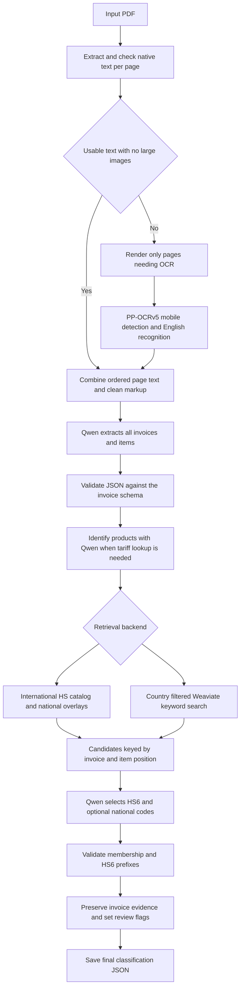

# Invoice OCR and tariff classification

The `AI` package converts a PDF into structured invoice JSON, retrieves tariff candidates, and asks Qwen to select from those candidates. The same implementation runs from the command line, Python, and both notebooks. All invoices and their line items are processed, including items with duplicate or missing SKUs.

`hs6_code` contains the inferred international six-digit code. National codes require country-specific candidates. When those candidates or sufficient product details are unavailable, national fields remain null and `needs_review` is true. Codes explicitly printed on an invoice are retained as evidence and always flagged for review.

## Processing flow



1. **Extract text first, then OCR.** PyMuPDF reads native PDF words and groups them by bounding boxes. A page uses native text when it has at least 40 non-whitespace characters, four words, sufficient alphanumeric content, no replacement/control characters, no extraction warnings, and less than 10% image area. Otherwise the whole page falls back to OCR so a native header cannot hide a scanned invoice body. This is a conservative heuristic; it cannot prove the text layer matches the visible invoice. Only fallback pages are rendered at `OCR_DPI` (default 250), and Paddle models are loaded only if a page needs OCR. PaddleOCR uses exactly `PP-OCRv5_mobile_det` for detection and `en_PP-OCRv5_mobile_rec` for English recognition. Document orientation, unwarping, and text-line orientation models are disabled. Bounding boxes are grouped into rows, with cells ordered left to right and separated by tabs. Pages retain PDF order with `<PAGE>` separators in `detailed_invoice_output.txt`. Empty pages and malformed results fail explicitly to avoid returning partial invoices. Temporary page images are removed on success and failure. This is geometric text ordering, not table structure recognition; rotated text and complex merged tables need accuracy checks.
2. **Clean.** Detection coordinates and markup are removed, preserving table cell boundaries and page breaks. The result is written to `plain_invoice_text.txt`. Empty OCR output stops the run.
3. **Extract.** Qwen receives the text and the shared JSON Schema. It extracts invoice, shipment, and line-item fields without inferring tariff codes. Missing values are null. Manufacturing country must come from product evidence; it is not copied from the sender's address.
4. **Validate extraction.** Missing invoice data fields are filled with null before validation, including fields in omitted order and shipment objects. Malformed JSON, unexpected fields, incorrect supplied field types, empty invoice lists, and empty item lists stop the run. Valid extraction is saved before classification modifies it.
5. **Retrieve missing codes.** Country-specific codes explicitly printed on the invoice take precedence. Items with both structurally valid national codes skip retrieval and classification; if every item is complete, the tariff backend is never opened or downloaded. For incomplete items, Weaviate queries only countries whose codes are missing or malformed. Records use `(invoice_index, item_index)`, so SKU collisions cannot overwrite another item's results. Country lookup uses exact names, ISO codes, and explicit aliases.
6. **Select and validate.** Qwen may choose only retrieved HS6 values. Each national code must occur in the corresponding country's candidate list and extend the chosen HS6. Invalid selections are rejected before formatting. An item's classification failure becomes a reviewable result; processing continues for other items.
7. **Persist.** Each item receives classification fields, evidence, and review status. The complete result is written to `final_classification.json` and returned to the caller.

## Files and responsibilities

| File | Responsibility |
| --- | --- |
| `main.py` | Full pipeline, progress events, CLI, and connection cleanup |
| `model.py` | Lazy model loading and process-local model reuse |
| `ocr.py` | PaddleOCR bounding-box validation and text row/column ordering |
| `utils.py` | PDF rendering, OCR, text cleaning, Qwen generation, extraction, and output writing |
| `schema.py` | Shared extraction contract and JSON Schema validation |
| `prompt.py` | Extraction instructions generated around that contract |
| `tariff.py` | Country resolution, retrieval backends, candidate validation, and classification |
| `db_connect.py` | Weaviate connection without API-key authentication |
| `model_config.py` | All model names, revisions, OCR settings, quantization, devices, precision, and generation budgets |
| `config.py` | Environment-based database settings and compatibility imports for model settings |
| `OCR_HTS_DB.ipynb`, `OCR_HTS.ipynb` | Notebook entry points calling `doc_pipeline()` |
| `tests/test_pipeline.py` | Regression tests with small PDFs and fake model/database responses |

Imports do not download models or contact databases. Qwen loads on the first full processing call; PaddleOCR loads only on the first page requiring OCR. Each background extraction worker caches its own models and inference locks, allowing two invoices to process concurrently by default. Direct calls outside a worker context share the default model cache and locks.

PDF validation and rendering share a separate lock; a MuPDF compressed-stream warning triggers one fresh-open render attempt. Persistent decompression errors fail before the rendered images reach OCR.

## Installation

Use Python 3.11 or later for the API. PaddleOCR and Qwen both run on GPU by default. Install `paddlepaddle-gpu` for OCR and a CUDA-enabled PyTorch build for Qwen. The A40 host uses Paddle CUDA 11.8 wheels; other hosts must use wheels compatible with their NVIDIA driver. PDF parsing, rendering, and file handling remain CPU operations.

Create an environment from the repository root:

```bash
python -m venv .venv
```

Activate it using `source .venv/bin/activate` on Linux, or `.venv\Scripts\Activate.ps1` in Windows PowerShell. Install a matching CUDA build of PyTorch for the GPU host, then install the package requirements:

```bash
python -m pip install -r AI/requirements.txt
```

For the API server, also install `server/requirements.txt`. Keep the full pipeline in one worker process per GPU unless you have provisioned memory for multiple copies of the OCR pipeline and Qwen.

The AI requirements require PyTorch 2.10 or later and pin Transformers 4.57.1. The server requirements contain only API dependencies so both files can be installed in one environment without conflicting model-library pins. On a CUDA 12.8 host, install PyTorch first with `python -m pip install torch==2.10.0 --index-url https://download.pytorch.org/whl/cu128`. Torchvision and torchaudio are not required by this text-only Qwen/PaddleOCR flow. Use the same interpreter for installation and server startup.

Model repositories are `PaddlePaddle/PP-OCRv5_mobile_det`, `PaddlePaddle/en_PP-OCRv5_mobile_rec`, and `Qwen/Qwen3-8B`. Qwen supports optional NF4 4-bit double quantization (`load_in_4bit` is currently `False` in `QWEN_QUANTIZATION_CONFIG`), BF16 compute by default (`QWEN_COMPUTE_DTYPE=auto` enables BF16/FP16 capability selection), SDPA attention, and one selected GPU without automatic CPU/disk offload. Thinking is disabled via the chat template for structured JSON generation. All use the shared Hugging Face cache and support `HF_TOKEN`. Override repositories with `OCR_DET_MODEL_ID`, `OCR_REC_MODEL_ID`, and `QWEN_MODEL_ID`; pin revisions with the corresponding `*_MODEL_REVISION` variables. The OCR loader supplies the downloaded local model directories to PaddleOCR.

OCR settings: `OCR_DEVICE=gpu:0` (default), `OCR_DPI=250`, and `OCR_RECOGNITION_BATCH_SIZE=32`. Install the GPU framework in the same environment as the API. Do not install both Paddle engine packages together:

```bash
python -m pip uninstall -y paddlepaddle paddlepaddle-gpu
python -m pip install paddlepaddle-gpu==3.2.2 --index-url https://www.paddlepaddle.org.cn/packages/stable/cu118/
python -m pip install -r AI/requirements.txt -r server/requirements.txt
```

Paddle's CUDA 11.8 and PyTorch's CUDA packages can both install `libnccl.so.2`
at the same location. After installing Paddle, restore the NCCL package required
by the installed CUDA PyTorch build so later Torch imports keep working:

```bash
python - <<'PY'
from importlib.metadata import requires
import subprocess
import sys

pins = [requirement for requirement in requires("torch") or []
        if requirement.split(";", 1)[0].strip().startswith("nvidia-nccl-")]
if pins:
    subprocess.run([sys.executable, "-m", "pip", "install",
                    "--force-reinstall", "--no-deps", *pins], check=True)
PY
```

If the official index is unavailable, the official CUDA 11.8 wheel for this Linux x86-64 / Python 3.12 host can be installed directly:

```bash
python -m pip install https://paddle-whl.bj.bcebos.com/stable/cu118/paddlepaddle-gpu/paddlepaddle_gpu-3.2.2-cp312-cp312-linux_x86_64.whl
```

Run the NCCL restoration step after a direct wheel installation too. Validate
both frameworks together before starting the API:

```bash
FLAGS_allocator_strategy=auto_growth python - <<'PY'
import torch
assert torch.cuda.is_available()
assert torch.tensor([1.0], device="cuda:0").sum().item() == 1.0
import paddle
assert paddle.device.is_compiled_with_cuda()
paddle.set_device("gpu:0")
assert float(paddle.to_tensor([1.0]).sum()) == 1.0
print("PyTorch and Paddle GPU operations passed")
PY
```

Paddle uses `gpu:0` device syntax, while PyTorch/Qwen uses `cuda:0`. `PADDLE_ENV_CONFIG` sets `FLAGS_allocator_strategy=auto_growth` before Paddle imports to allocate GPU memory as needed. Explicit environment values take precedence. Restart the API after changing settings or framework packages. See the [official Paddle installation guide](https://www.paddlepaddle.org.cn/en/install/quick) for other CUDA/Python combinations.

## Model configuration

Edit all model names and inference settings in [`model_config.py`](model_config.py).
It contains configuration values only; model loading stays in `model.py` and
Weaviate connection settings stay in `config.py`. Existing `Qconfig`, `Qruntime`,
and `Oconfig` imports remain compatible through aliases.

| Configuration | Controls |
| --- | --- |
| `MODEL_DEFAULTS` | Detection, recognition, and Qwen repository names |
| `MODEL_REVISIONS` | Optional revision pins for `ocr_det`, `ocr_rec`, and `qwen`; defaults to `None` |
| `MODEL_CACHE_CONFIG` | Default cache base, vendor directory, and hub directory |
| `OCR_CONFIG` | Paddle device, rendering DPI, recognition batch size, and native PDF text routing |
| `PADDLE_ENV_CONFIG` | Paddle runtime environment defaults, including GPU memory growth |
| `OCR_PIPELINE_CONFIG` | Optional orientation and unwarping models; all disabled by default |
| `QWEN_RUNTIME_CONFIG` | GPU device, compute dtype, and accepted context budget |
| `QWEN_QUANTIZATION_CONFIG` | Optional 4-bit NF4 and double quantization settings; disabled when `load_in_4bit=False` |
| `QWEN_LOAD_CONFIG` | SDPA attention and low-memory model loading |
| `QWEN_CHAT_TEMPLATE_CONFIG` | Chat formatting and thinking mode; thinking is disabled |
| `QWEN_GENERATION_CONFIG` | Invoice extraction output budget: 15,000 tokens, temperature 0.0 |
| `GENERATION_DEFAULTS` | Direct generator defaults: 8,000 tokens, temperature 0.0 |
| `PRODUCT_GENERATION_CONFIG` | Product identification budget: 1,000 tokens, temperature 0.0 |
| `TARIFF_GENERATION_CONFIG` | Per-item classification budget: 700 tokens, temperature 0.0 |

`Qconfig` aliases `QWEN_GENERATION_CONFIG`, `Qruntime` aliases
`QWEN_RUNTIME_CONFIG`, and `Oconfig` aliases `OCR_CONFIG`. Use the descriptive
configuration names for new code. `AI/config.py` re-exports the aliases for
existing callers; it no longer defines separate model settings.

Repository environment overrides take precedence over `MODEL_DEFAULTS`:
`OCR_DET_MODEL_ID`, `OCR_REC_MODEL_ID`, and `QWEN_MODEL_ID`. Their corresponding
`*_MODEL_REVISION` variables override `MODEL_REVISIONS`. Cache resolution is
`HF_HUB_CACHE`, `HUGGINGFACE_HUB_CACHE`, `HF_HOME/hub`, then the XDG/home defaults.

After editing this file or setting environment variables, restart the API.
Configuration changes do not replace objects already cached in a running worker.
`POST /api/v1/models/download` downloads files; it does not switch a loaded model.
Use `GET /api/v1/models/status` to inspect files and `/api/v1/gpu/status` to see
which model bundles are loaded across extraction workers in that API process.

## Performance and memory settings


The default configuration places PaddleOCR on `gpu:0` and Qwen3-8B on `cuda:0`, sharing the first visible GPU.
Background extraction uses `INVOICE_WORKERS=2` by default, with independent model copies and concurrent KV caches. GPU memory must accommodate both. Set `INVOICE_WORKERS=1` for serial processing. Use one Uvicorn process so all queued invoices share the same worker limit. Native-only PDFs do not render images or load PaddleOCR.
`download_models(include_ocr=False)` loads only Qwen; the default helper call
still explicitly loads both OCR and Qwen for callers that want to preload them.

| Variable | Default | Purpose |
| --- | --- | --- |
| `PDF_TEXT_FIRST` | `true` | Set `false` to force OCR on every page |
| `PDF_TEXT_MIN_CHARS` | `40` | Minimum non-whitespace native characters per page |
| `OCR_DEVICE` | `gpu:0` | Paddle GPU device; requires the GPU framework wheel |
| `OCR_DPI` | `250` | Rendering resolution for fallback pages |
| `OCR_RECOGNITION_BATCH_SIZE` | `32` | Text recognition crop batch size |
| `QWEN_DEVICE` | `cuda:0` | GPU for all Qwen weights |
| `QWEN_COMPUTE_DTYPE` | `bfloat16` | `auto`, `bfloat16`, `float16`, or `float32` compute dtype |
| `QWEN_MAX_CONTEXT_TOKENS` | `32768` | Prompt plus output budget cap, bounded by model context |
| `QWEN_MAX_NEW_TOKENS` | `15000` | Extraction output ceiling; reaching it fails rather than returning truncated JSON |

The context cap bounds accepted sequence lengths; it is not a hard GPU memory
quota. Lower it for tighter memory budgets, keeping it larger than the prompt
plus the output ceiling. Large invoices can require more memory and generation
work. Do not increase worker count to accelerate one invoice: each worker loads
another model copy. Model/revision overrides take precedence over defaults;
remove an old `QWEN_MODEL_ID` override when switching to Qwen3-8B. Restart the API
to replace models already cached in memory.

Every processing stage emits a `performance` JSON log with `run_id`, `stage`,
`elapsed_ms`, and `status`. Timings cover uploads, queue wait, model loading,
pipeline/OCR lock wait, native extraction, fallback rendering, OCR per page,
cleanup, JSON extraction and validation, product identification, tariff setup
and retrieval, item classification, file saves, and total pipeline duration.
Qwen decode logs also include input/output token counts and current GPU allocated
and reserved MiB. OCR page timing includes detection and recognition together.
Queued processing uses the job ID as `run_id`; nested stages share that ID.
Failures log their exception type without adding invoice text. Nested durations
overlap and must not be added together. Generation timings include device work
needed to return output tokens; they are wall-clock timings, not CUDA kernel profiles.

Run through `bash scripts/run_server.sh` to save these records in
`logs/server.log`. Search for `performance` to compare first-request model loading
with warm requests. No end-to-end latency target is implied by the model change;
benchmark native, scanned, and mixed invoices against their original values.

## Run from the command line

Run from the repository root:

```bash
python -m AI.main /absolute/path/invoice.pdf
```

On Windows, pass a normal Windows path instead. By default, the pipeline creates a unique `output/<document-stem>_<run-id>/` directory and prints its location. To choose the directory and use local reference data:

```bash
python -m AI.main invoice.pdf --output output/review-001 --catalog data/harmonized-system.csv --national-index data/national-tariffs.json
```

Use a fresh output directory for each run. A failed run can leave intermediate files for diagnosis; it does not produce a new successful final result.

The CLI accepts `--backend catalog` (default) or `--backend weaviate`. Models and reference data are separate inputs: the Hugging Face model cache does not contain the tariff catalog.

## Run from Python or a notebook

```python
from AI.main import doc_pipeline

result = doc_pipeline(
    "invoice.pdf",
    "output/review-002",
    catalog_path="data/harmonized-system.csv",
    national_path="data/national-tariffs.json",
    progress=print,
)

for invoice in result["invoices"]:
    for item in invoice["item_level"]:
        print(item["sku_code"], item["hs6_code"], item["needs_review"])
```

`hts_classification_pipeline` is an alias for `doc_pipeline`. The notebooks locate the repository, configure paths, call this function, and display every invoice. Set `REPO_ROOT` when launching from outside the checkout. Colab users must clone or mount the checkout before importing `AI`; no Colab secret API is required.

For repeated documents, call `doc_pipeline()` with a different output directory each time. Loaded models are reused automatically. Callers can inject `models`, `retriever`, and `generate` for testing or a controlled runtime.

## Catalog retrieval

Set `--catalog` or `HS_CATALOG_PATH` to a local CSV. Without a local path, catalog mode downloads the [public Harmonized System dataset](https://github.com/datasets/harmonized-system) over HTTPS with a timeout. Network failure stops the run; an unrelated fallback catalog is not substituted.

CSV rows require a code field (`hscode`, `hs_code`, or `code`) and a description field (`description` or `title`). Two- and four-digit rows provide parent context; six-digit rows are selectable candidates. Retrieval scores overlapping words with inverse document frequency, including parent descriptions. It returns at most 12 HS6 candidates per item.

National overlays are optional JSON arrays configured by `--national-index` or `NATIONAL_INDEX_PATH`. Each row has:

| Field | Value |
| --- | --- |
| `jurisdiction` | Exact country name or ISO code, normalized to ISO2 |
| `hs6` | Six-digit code that exists in the loaded catalog |
| `national_code` | Numeric national extension of that HS6, with optional dots, spaces, or hyphens |
| `title` | Description shown to the selecting model |
| `legal_text` | Optional additional source text |

Overlay codes must contain 7 to 12 digits and begin with their HS6. New Zealand codes may instead contain ten digits followed by one check letter; the complete code is preserved and matched, including that letter. Rows with invalid countries, missing catalog codes, or inconsistent prefixes fail at loading. Supply catalog and national data from compatible editions and retain their source/version records. The loader checks structure and membership; it does not establish that a file is an official or current tariff schedule.

## Weaviate retrieval

```bash
python -m AI.main invoice.pdf --backend weaviate
```

Configure the connection using environment variables:

| Variable | Default |
| --- | --- |
| `WEAVIATE_HOST` | `32.236.127.40` |
| `WEAVIATE_HTTP_PORT` | `8080` |
| `WEAVIATE_GRPC_PORT` | `50051` |
| `WEAVIATE_HTTP_SECURE` | `false` |
| `WEAVIATE_GRPC_SECURE` | `false` |

The database connection does not require an API key and sends no authentication credentials.

The `Hs_category` collection must expose `country_code`, `code`, `description`, and `indent` properties. `country_code` is queried as a string. Country database IDs are mapped from `https://bapi.logistx.us/his_countries`. API labels such as `Finland - FI (EU)` are parsed using their validated ISO suffix. Standard country entries take precedence over alternate schedules such as `Israel (11 digits) - IL`, regardless of API order. Inactive and invalid entries are skipped; conflicting standard IDs fail explicitly. An unavailable API fails the run; an unmapped country produces no candidates for that role.

BM25 retrieves at most 25 rows per distinct origin/destination country. A second country-filtered code-prefix lookup retrieves up to 100 rows per country, including national entries described only as "Other" that keyword search misses. Prefixes come from invoice tariff evidence when available, otherwise from the retrieved HS6 candidates. Six-digit rows provide international candidates; longer national rows provide candidates unless marked as non-leaf headings. New Zealand statistical check letters are retained and validated within that jurisdiction. Parent descriptions are supplied where retrieved to clarify titles such as "Other". Duplicate national codes are removed, and inactive/deleted rows are excluded. Destination uses `destination_country`, falling back to `receiver_country`. Origin and destination share lookups when the countries match. Search relevance is not used to fabricate a parent-child tree. This backend's candidate coverage depends on database contents and the search limits; the model must still select and validate a suitable national code.

The pipeline closes the Weaviate connection in a `finally` block, including on failure. Callers using `connect_vdb()` themselves own and must close its returned client.

Before tariff candidate retrieval, the invoice pipeline runs product identification
for invoices with at least one item that needs tariff lookup. It saves positional
profiles to `product_identification.json`, uses each profile's search query for the
catalog/Weaviate search, and includes the profile alongside the original description
when Qwen selects among candidates. Original invoice descriptions and tariff evidence
remain available for validation; model identification does not itself choose a code.
Items with complete invoice tariff codes skip both retrieval and product identification.

## Output contract

Every output directory contains these files after a successful run:

| File | Contents |
| --- | --- |
| `detailed_invoice_output.txt` | Raw model-returned OCR |
| `plain_invoice_text.txt` | Cleaned text supplied to Qwen |
| `extracted_invoice.json` | Schema-validated extraction before classification |
| `db_matches.json` | Retrieved candidates, countries, source, and positional item identity |
| `final_classification.json` | All invoices with classification results and review flags |

Extraction has three groups per invoice: `order_level`, `item_level`, and `shipment`. The exact fields and nullable types are defined in `schema.py`. Quantity is numeric and may be fractional. Monetary values remain in the invoice's stated currency.

`order_level` includes company and invoice details; separate shipper and receiver contact/address fields (including email, phone, state, and both address lines); gross/net weights; package count; total quantity, amount, item value, and shipping/handling; dimensions in cm; origin/destination phone codes; and shipment origin/destination countries. All 42 data fields are optional during extraction; omitted fields are returned as null in the normalized output. Weights, quantities, and amounts are numbers; `package_count` is an integer. Phone numbers/calling codes, postal codes, and `dimensions_cm` remain strings. Shipment origin is separate from each item's country of manufacture.

Invoices may name three or more countries. `item_level.country_of_manufacture` represents product origin (Country of Origin/COO/Made in), while `order_level.origin_country` represents shipment departure/export. For goods made in China, exported from the UK, and delivered to Australia, these fields are China, United Kingdom, and Australia (`destination_country`) respectively. Origin national tariff retrieval uses China. Item-specific manufacturing evidence takes precedence over a declaration covering all goods, so different items may have different manufacturing countries. When product-origin evidence is absent, it stays null; the exporter or shipper country is not substituted.

Classification adds:

| Field | Meaning |
| --- | --- |
| `hs6_code` | Selected international HS6, or null |
| `hs_code` | Four-digit heading when the invoice supplies only four digits; otherwise the first six digits of a valid numeric invoice code, or the inferred HS6. Original printed codes remain in `invoice_tariff_codes` |
| `manufacturing_country_hts_code` | Full national code explicitly extracted for the manufacturing country takes precedence; if missing or malformed, use the validated origin-country candidate, otherwise null |
| `manufacturing_country_hts_source` | `invoice`, the retrieval source, or null when no origin national code is available |
| `destination_country_hts_code` | Destination national candidate, or retained invoice value |
| `destination_tariff_code` | Alias of the final destination national field |
| `invoice_tariff_codes` | Original explicitly extracted code values, when present |
| `candidate_hs` | Retrieved international candidate codes |
| `hts_origin_iso`, `hts_destination_iso` | Resolved jurisdiction metadata |
| `confidence` | Model-reported confidence, restricted to HIGH, MEDIUM, or LOW |
| `needs_review` | True for missing destination/national coverage, rejected selections, failures, model uncertainty, or invoice-supplied code evidence |
| `validation_note` | Validation results and reasons for review |
| `classification_reason` | Model explanation or failure reason |

National candidates passed to the selecting model are filtered to the allowed HS6 set. A rejected HS6 selection receives LOW confidence and an explicit rejection reason; its original model explanation is not presented as a successful classification.

Review flags take priority over confidence. A result requiring review cannot retain HIGH confidence. Invoice-supplied codes may conflict with inferred codes; the original values are preserved as evidence, and the row remains reviewable. A sender's country is not used as a substitute for country of manufacture.

## Server integration

For long requests behind Cloudflare, use `POST /api/v1/invoices/jobs` to upload the PDF and receive a job ID immediately after validation. Poll `GET /api/v1/invoices/jobs/{job_id}` for progress and the final JSON in `result`. Completed job results are persisted under `INVOICE_JOB_DIR` until the successful final response is sent, then that job's directory is deleted. Delivered results remain available in process memory until restart; clients should save the final JSON. Active jobs interrupted by a server restart must be submitted again.

The FastAPI service exposes `POST /api/v1/invoices/extract`: upload an invoice PDF in multipart field `file` to receive `202` with a background job ID after validation. Track `/ws/invoices/jobs/{job_id}` or poll `/api/v1/invoices/jobs/{job_id}` for progress and final JSON. Add `?wait=true` only to wait for final JSON in the upload response; that explicit synchronous mode can exceed proxy timeouts. The upload endpoint defaults to the Weaviate backend at the configured host without an API key; set `INVOICE_TARIFF_BACKEND=catalog` to use the catalog instead. Uploaded files and temporary pipeline artifacts are removed after processing.

The WebSocket endpoint `/ws/invoices/extract` accepts JSON filename/size metadata followed by binary PDF chunks. It runs the same processor and sends progress events followed by a `completed` event whose `result` contains the invoice JSON. See the server guide for the message protocol and client example.

Call `POST /api/v1/models/download` without a body to download and store all three model repositories before processing invoices. It returns cache snapshot paths and revisions without importing Torch or loading model objects. The inference loaders use the same cache directory. `GET /api/v1/models/status` checks cached weights, including all shards in a weight index.

The existing path-based `/api/v1/jobs` endpoints remain OCR-only. Their processor imports `AI.model` and `AI.utils`, loads only OCR, and returns raw and cleaned text paths. Their REST/WebSocket contract is unchanged. See [`server/README.md`](../server/README.md) for upload examples, API flow, configuration, error codes, and startup commands.

## Verification and limits

Run the regression suite from the repository root:

```bash
python -m unittest discover -s AI/tests -v
```

Tests use local generated PDFs and fake model/database responses. They cover country matching, national-prefix rejection, absent overlays, preserved invoice evidence, multiple invoices, duplicate/missing SKUs, temporary-file cleanup, context budgets, truncation detection, and imports without model/network side effects. Synthetic national codes in test fixtures test validation mechanics, not tariff correctness.

A real GPU smoke test should process a known invoice and compare every extracted item, quantity, amount, country, and code with the source PDF. Schema validation verifies structure, not whether OCR or Qwen captured every line. The pipeline does not reconcile financial totals, split oversized documents automatically, prove tariff applicability from legal notes, or calibrate model confidence. Context overflow and output-token exhaustion fail explicitly rather than silently accepting truncated JSON. Short or ambiguous descriptions can still retrieve poor candidates; such results need review even when candidate membership passes.

## Standalone product identification

`product_pipeline.py` identifies product types and creates keyword queries before
HS/HTS retrieval. It accepts extracted or classified invoice JSON, uses the cached
Qwen model, and does not run OCR or select tariff codes. The existing invoice
pipeline does not invoke it automatically.

```bash
python -m AI.product_pipeline output/review-002/extracted_invoice.json --output output/review-002/products.json
```

```python
from AI.product_pipeline import identify_products

profiles = identify_products(extracted_invoice, "output/products.json")
for product in profiles["products"]:
    invoice = extracted_invoice["invoices"][product["invoice_index"]]
    item = invoice["item_level"][product["item_index"]]
    query = product["identification"]["search_query"]
    if query:
        candidates = retriever.retrieve(
            {**item, "product_description": query}, invoice["order_level"]
        )
```

Each result retains invoice/item positions and SKU, with `identification` containing
`exact_product_name` (specific name preserved from the invoice, including stated
brand/model), `product_type` (generic category), `primary_function`, `intended_use`, `material`, `construction`,
`part_or_accessory_of`, `search_terms`, `search_query`, `missing_information`,
`needs_review`, and `error`. Unknown detail fields are null. No-description items
skip inference. Invalid or failed model responses flag that item for review and
use its original description as the search query; remaining items continue.
Model-loading failures stop the run. Input invoices are not modified.

These profiles are model-generated search aids, not verified product facts or
validated tariff classifications. Preserve original descriptions as evidence and
continue applying candidate membership/country validation when selecting codes.
