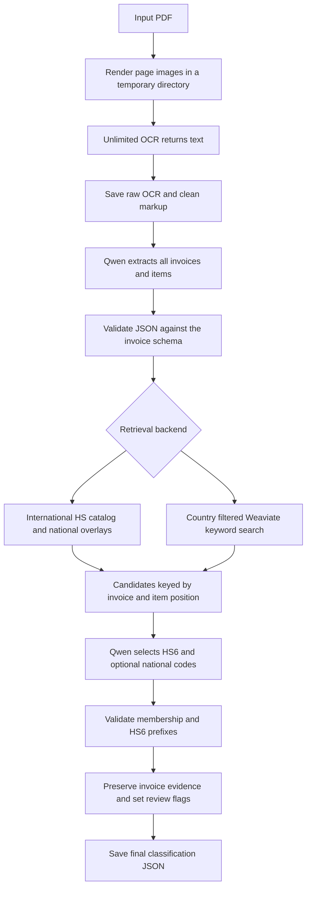

# Invoice OCR and tariff classification

The `AI` package converts a PDF into structured invoice JSON, retrieves tariff candidates, and asks Qwen to select from those candidates. The same implementation runs from the command line, Python, and both notebooks. All invoices and their line items are processed, including items with duplicate or missing SKUs.

`hs6_code` contains the inferred international six-digit code. National codes require country-specific candidates. When those candidates or sufficient product details are unavailable, national fields remain null and `needs_review` is true. Codes explicitly printed on an invoice are retained as evidence and always flagged for review.

## Processing flow



1. **Render and OCR.** PyMuPDF renders every page at the configured DPI. `infer_multi()` processes the page images and returns text directly. Temporary images are removed on success and failure. The raw text is written to `detailed_invoice_output.txt`.
2. **Clean.** Detection coordinates and markup are removed, preserving table cell boundaries and page breaks. The result is written to `plain_invoice_text.txt`. Empty OCR output stops the run.
3. **Extract.** Qwen receives the text and the shared JSON Schema. It extracts invoice, shipment, and line-item fields without inferring tariff codes. Missing values are null. Manufacturing country must come from product evidence; it is not copied from the sender's address.
4. **Validate extraction.** Malformed JSON, missing fields, unexpected fields, incorrect field types, empty invoice lists, and empty item lists stop the run. Valid extraction is saved before classification modifies it.
5. **Retrieve.** The selected backend returns international and country-specific candidates for each item. Records use `(invoice_index, item_index)`, so SKU collisions cannot overwrite another item's results. Country lookup uses exact names, ISO codes, and explicit aliases.
6. **Select and validate.** Qwen may choose only retrieved HS6 values. Each national code must occur in the corresponding country's candidate list and extend the chosen HS6. Invalid selections are rejected before formatting. An item's classification failure becomes a reviewable result; processing continues for other items.
7. **Persist.** Each item receives classification fields, evidence, and review status. The complete result is written to `final_classification.json` and returned to the caller.

## Files and responsibilities

| File | Responsibility |
| --- | --- |
| `main.py` | Full pipeline, progress events, CLI, and connection cleanup |
| `model.py` | Lazy model loading and process-local model reuse |
| `utils.py` | PDF rendering, OCR, text cleaning, Qwen generation, extraction, and output writing |
| `schema.py` | Shared extraction contract and JSON Schema validation |
| `prompt.py` | Extraction instructions generated around that contract |
| `tariff.py` | Country resolution, retrieval backends, candidate validation, and classification |
| `db_connect.py` | Weaviate connection without API-key authentication |
| `config.py` | Inference defaults and environment-based database settings |
| `OCR_HTS_DB.ipynb`, `OCR_HTS.ipynb` | Notebook entry points calling `doc_pipeline()` |
| `tests/test_pipeline.py` | Regression tests with small PDFs and fake model/database responses |

Imports do not download models or contact databases. Models load on the first processing call and remain cached in that process. Full pipeline calls are serialized; OCR inference also has a shared lock because the model temporarily changes its configuration.

## Installation

Use Python 3.10 or later and a CUDA GPU with BF16 support for Unlimited-OCR. The OCR model implementation moves tensors to CUDA and uses BF16 autocast internally. Qwen can load on CPU, but that does not make the full OCR pipeline CPU-compatible.

Create an environment from the repository root:

```bash
python -m venv .venv
```

Activate it using `source .venv/bin/activate` on Linux, or `.venv\Scripts\Activate.ps1` in Windows PowerShell. Install a matching CUDA build of PyTorch and torchvision for the GPU host, then install the package requirements:

```bash
python -m pip install -r AI/requirements.txt
```

For the API server, also install `server/requirements.txt`. Keep the full pipeline in one worker process per GPU unless you have provisioned memory for multiple copies of both models.

The requirements pin PyTorch 2.10.0 and torchvision 0.25.0 together. On the A100 host, install their CUDA 12.8 builds before the requirements with `python -m pip install torch==2.10.0 torchvision==0.25.0 --index-url https://download.pytorch.org/whl/cu128`. Use the same interpreter for package installation and server startup; see the exact `/workspace/server/venv/bin/python` commands in [`server/README.md`](../server/README.md).

Model defaults are `baidu/Unlimited-OCR` and `Qwen/Qwen2.5-7B-Instruct`. Hugging Face uses its normal cache and `HF_TOKEN` environment variable. Set `OCR_MODEL_REVISION` and `QWEN_MODEL_REVISION` to commit hashes when reproducible model code and weights are required. Unlimited-OCR loads custom model code with `trust_remote_code=True`.

The adapter uses the text returned by [`infer_multi()`](https://huggingface.co/baidu/Unlimited-OCR/blob/main/modeling_unlimitedocr.py). It passes `save_results=False` to avoid the model's markdown postprocessor discarding text without page markers. The expected return is a string or a tuple whose first element is text; unsupported returns fail explicitly.

## Run from the command line

Run from the repository root:

```bash
python -m AI.main /absolute/path/invoice.pdf
```

On Windows, pass a normal Windows path instead. By default, the pipeline creates a unique `output/<document-stem>_<run-id>/` directory and prints its location. To choose the directory and use local reference data:

```bash
python -m AI.main invoice.pdf --output output/review-001 --catalog data/harmonized-system.csv --national-index data/national-tariffs.json
```

Use a fresh output directory for each run. A failed run can leave intermediate files for diagnosis; it does not produce a new successful final result.

The CLI accepts `--backend catalog` (default) or `--backend weaviate`. Models and reference data are separate inputs: the Hugging Face model cache does not contain the tariff catalog.

## Run from Python or a notebook

```python
from AI.main import doc_pipeline

result = doc_pipeline(
    "invoice.pdf",
    "output/review-002",
    catalog_path="data/harmonized-system.csv",
    national_path="data/national-tariffs.json",
    progress=print,
)

for invoice in result["invoices"]:
    for item in invoice["item_level"]:
        print(item["sku_code"], item["hs6_code"], item["needs_review"])
```

`hts_classification_pipeline` is an alias for `doc_pipeline`. The notebooks locate the repository, configure paths, call this function, and display every invoice. Set `REPO_ROOT` when launching from outside the checkout. Colab users must clone or mount the checkout before importing `AI`; no Colab secret API is required.

For repeated documents, call `doc_pipeline()` with a different output directory each time. Loaded models are reused automatically. Callers can inject `models`, `retriever`, and `generate` for testing or a controlled runtime.

## Catalog retrieval

Set `--catalog` or `HS_CATALOG_PATH` to a local CSV. Without a local path, catalog mode downloads the [public Harmonized System dataset](https://github.com/datasets/harmonized-system) over HTTPS with a timeout. Network failure stops the run; an unrelated fallback catalog is not substituted.

CSV rows require a code field (`hscode`, `hs_code`, or `code`) and a description field (`description` or `title`). Two- and four-digit rows provide parent context; six-digit rows are selectable candidates. Retrieval scores overlapping words with inverse document frequency, including parent descriptions. It returns at most 12 HS6 candidates per item.

National overlays are optional JSON arrays configured by `--national-index` or `NATIONAL_INDEX_PATH`. Each row has:

| Field | Value |
| --- | --- |
| `jurisdiction` | Exact country name or ISO code, normalized to ISO2 |
| `hs6` | Six-digit code that exists in the loaded catalog |
| `national_code` | Numeric national extension of that HS6, with optional dots, spaces, or hyphens |
| `title` | Description shown to the selecting model |
| `legal_text` | Optional additional source text |

Overlay codes must contain 7 to 12 digits and begin with their HS6. Rows with invalid countries, missing catalog codes, or inconsistent prefixes fail at loading. Supply catalog and national data from compatible editions and retain their source/version records. The loader checks structure and membership; it does not establish that a file is an official or current tariff schedule.

## Weaviate retrieval

```bash
python -m AI.main invoice.pdf --backend weaviate
```

Configure the connection using environment variables:

| Variable | Default |
| --- | --- |
| `WEAVIATE_HOST` | `32.236.127.40` |
| `WEAVIATE_HTTP_PORT` | `8080` |
| `WEAVIATE_GRPC_PORT` | `50051` |
| `WEAVIATE_HTTP_SECURE` | `false` |
| `WEAVIATE_GRPC_SECURE` | `false` |

The database connection does not require an API key and sends no authentication credentials.

The `Hs_category` collection must expose `country_code`, `code`, `description`, and `indent` properties. `country_code` is queried as a string. Country database IDs are mapped from `https://bapi.logistx.us/his_countries`. API labels such as `Finland - FI (EU)` are parsed using their validated ISO suffix. Standard country entries take precedence over alternate schedules such as `Israel (11 digits) - IL`, regardless of API order. Inactive and invalid entries are skipped; conflicting standard IDs fail explicitly. An unavailable API fails the run; an unmapped country produces no candidates for that role.

BM25 retrieves at most 25 rows per distinct origin/destination country. Six-digit rows provide international candidates; longer numeric rows also provide national candidates. Origin and destination can share the same lookup when the countries match. Search relevance is not used to fabricate a parent-child tree. This backend's candidate coverage depends on database contents and the search limit.

The pipeline closes the Weaviate connection in a `finally` block, including on failure. Callers using `connect_vdb()` themselves own and must close its returned client.

## Output contract

Every output directory contains these files after a successful run:

| File | Contents |
| --- | --- |
| `detailed_invoice_output.txt` | Raw model-returned OCR |
| `plain_invoice_text.txt` | Cleaned text supplied to Qwen |
| `extracted_invoice.json` | Schema-validated extraction before classification |
| `db_matches.json` | Retrieved candidates, countries, source, and positional item identity |
| `final_classification.json` | All invoices with classification results and review flags |

Extraction has three groups per invoice: `order_level`, `item_level`, and `shipment`. The exact fields and nullable types are defined in `schema.py`. Quantity is numeric and may be fractional. Monetary values remain in the invoice's stated currency.

Classification adds:

| Field | Meaning |
| --- | --- |
| `hs6_code` | Selected international HS6, or null |
| `hs_code` | Inferred HS6 fallback; a valid numeric invoice-supplied value takes precedence when present |
| `manufacturing_country_hts_code` | Origin national candidate, or retained invoice value |
| `destination_country_hts_code` | Destination national candidate, or retained invoice value |
| `destination_tariff_code` | Alias of the final destination national field |
| `invoice_tariff_codes` | Original explicitly extracted code values, when present |
| `candidate_hs` | Retrieved international candidate codes |
| `hts_origin_iso`, `hts_destination_iso` | Resolved jurisdiction metadata |
| `confidence` | Model-reported confidence, restricted to HIGH, MEDIUM, or LOW |
| `needs_review` | True for missing destination/national coverage, rejected selections, failures, model uncertainty, or invoice-supplied code evidence |
| `validation_note` | Validation results and reasons for review |
| `classification_reason` | Model explanation or failure reason |

Review flags take priority over confidence. A result requiring review cannot retain HIGH confidence. Invoice-supplied codes may conflict with inferred codes; the original values are preserved as evidence, and the row remains reviewable. A sender's country is not used as a substitute for country of manufacture.

## Server integration

For long requests behind Cloudflare, use `POST /api/v1/invoices/jobs` to upload the PDF and receive a job ID immediately after validation. Poll `GET /api/v1/invoices/jobs/{job_id}` for progress and the final JSON in `result`. Completed job results are persisted under `INVOICE_JOB_DIR`; active jobs interrupted by a server restart must be submitted again.

The FastAPI service exposes `POST /api/v1/invoices/extract`: upload an invoice PDF in multipart field `file` to receive `202` with a background job ID after validation. Track `/ws/invoices/jobs/{job_id}` or poll `/api/v1/invoices/jobs/{job_id}` for progress and final JSON. Add `?wait=true` only to wait for final JSON in the upload response; that explicit synchronous mode can exceed proxy timeouts. The upload endpoint defaults to the Weaviate backend at the configured host without an API key; set `INVOICE_TARIFF_BACKEND=catalog` to use the catalog instead. Uploaded files and temporary pipeline artifacts are removed after processing.

The WebSocket endpoint `/ws/invoices/extract` accepts JSON filename/size metadata followed by binary PDF chunks. It runs the same processor and sends progress events followed by a `completed` event whose `result` contains the invoice JSON. See the server guide for the message protocol and client example.

Call `POST /api/v1/models/download` without a body to download and store both model repositories before processing invoices. It returns cache snapshot paths and revisions without importing Torch or loading model objects. The inference loaders use the same cache directory. `GET /api/v1/models/status` checks cached weights, including all shards in a weight index.

The existing path-based `/api/v1/jobs` endpoints remain OCR-only. Their processor imports `AI.model` and `AI.utils`, loads only OCR, and returns raw and cleaned text paths. Their REST/WebSocket contract is unchanged. See [`server/README.md`](../server/README.md) for upload examples, API flow, configuration, error codes, and startup commands.

## Verification and limits

Run the regression suite from the repository root:

```bash
python -m unittest discover -s AI/tests -v
```

Tests use local generated PDFs and fake model/database responses. They cover country matching, national-prefix rejection, absent overlays, preserved invoice evidence, multiple invoices, duplicate/missing SKUs, temporary-file cleanup, context budgets, truncation detection, and imports without model/network side effects. Synthetic national codes in test fixtures test validation mechanics, not tariff correctness.

A real GPU smoke test should process a known invoice and compare every extracted item, quantity, amount, country, and code with the source PDF. Schema validation verifies structure, not whether OCR or Qwen captured every line. The pipeline does not reconcile financial totals, split oversized documents automatically, prove tariff applicability from legal notes, or calibrate model confidence. Context overflow and output-token exhaustion fail explicitly rather than silently accepting truncated JSON. Short or ambiguous descriptions can still retrieve poor candidates; such results need review even when candidate membership passes.
