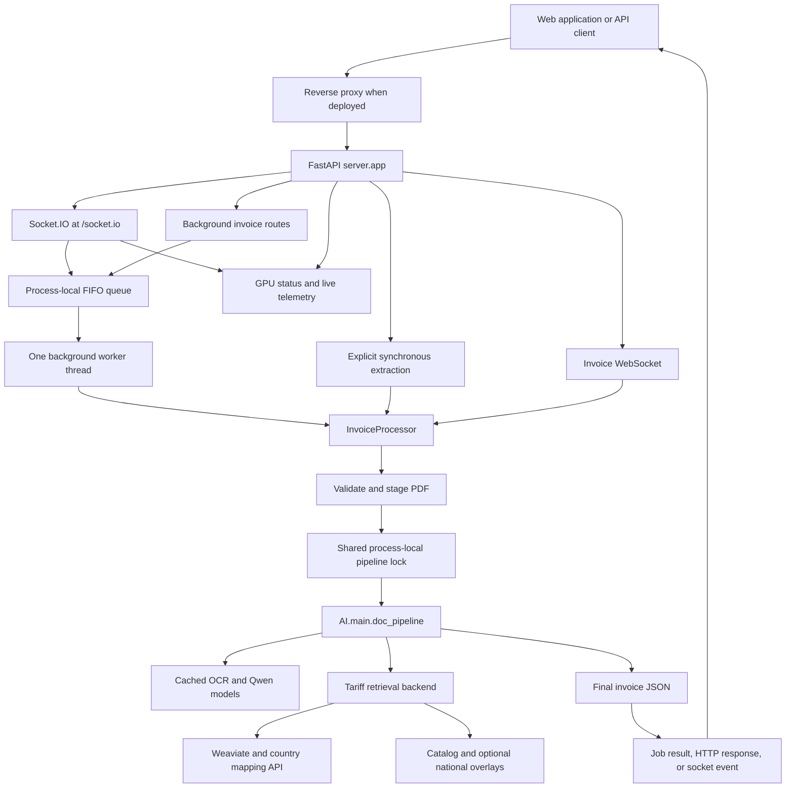
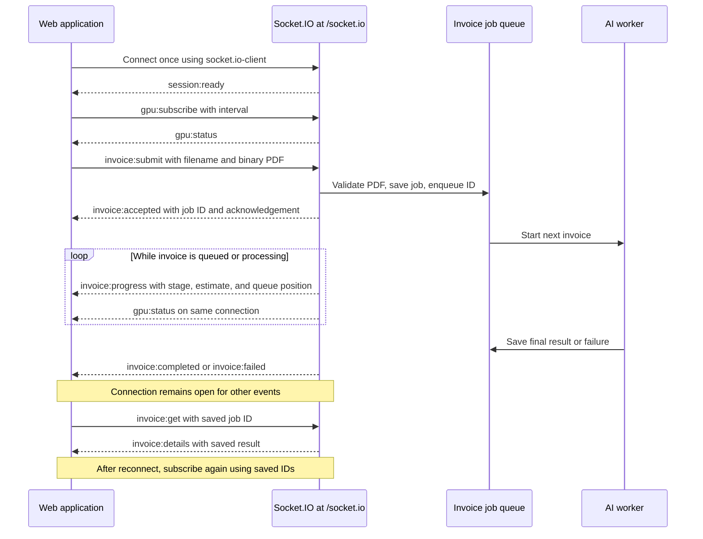
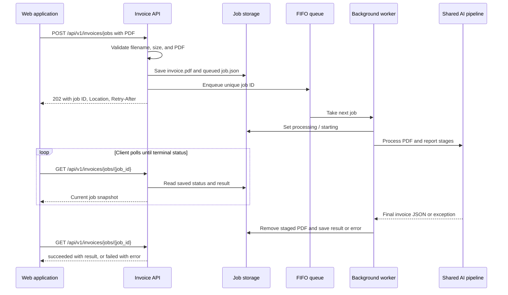
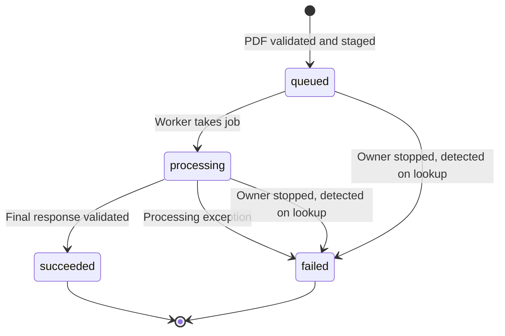
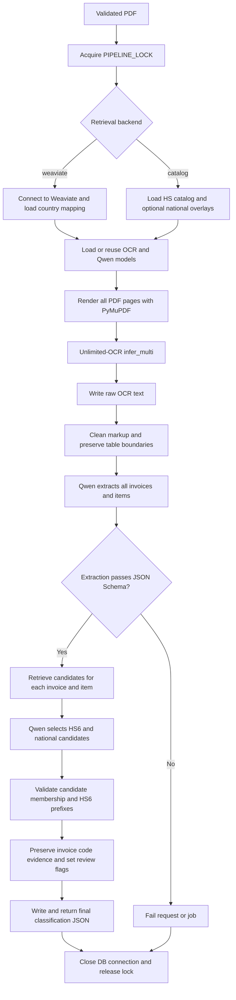
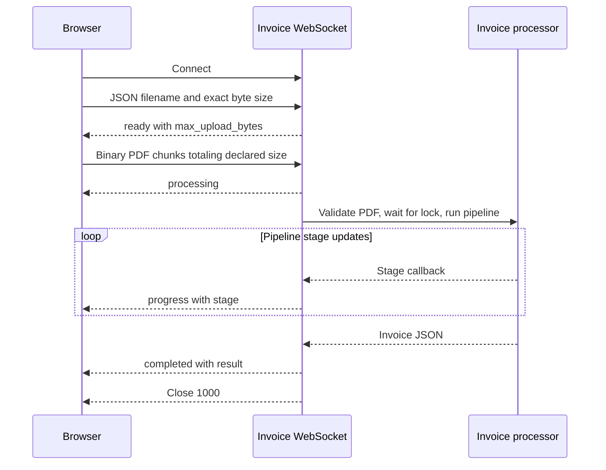
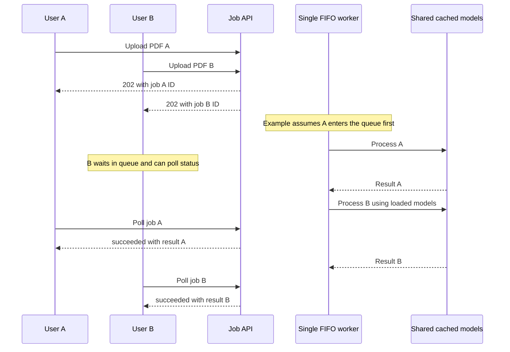
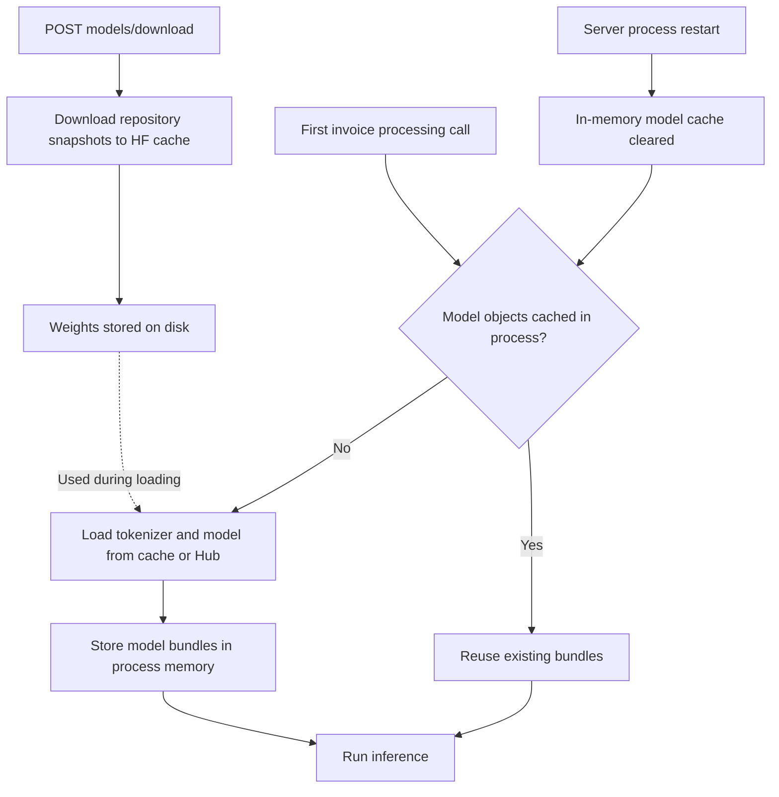

# Invoice AI: architecture, processing flow, and usage

## Socket.IO: multiple events on one connection

Connect a Socket.IO v4 client to the API origin with `path: "/socket.io"`. One connection supports `invoice:submit`, job lookup/subscription, progress/queue updates, final JSON, and GPU status. See the [complete Socket.IO guide](server/SOCKETIO_GUIDE.md) for event payloads and a working browser example. The older `/ws/...` endpoints use plain WebSocket protocols and remain available.


## Extraction requests and timeouts

`POST /api/v1/invoices/extract` now returns **202 with a background job ID by default** after receiving and validating the PDF. It does not keep the upload request open during model loading or inference. Existing clients expecting final invoice JSON in this response must handle the job workflow below, or explicitly opt into synchronous mode with `?wait=true` (which remains susceptible to proxy timeouts).

```bash
curl -X POST http://localhost:8000/api/v1/invoices/extract \
  -F 'file=@invoice.pdf;type=application/pdf'
# Use the returned job_id:
curl http://localhost:8000/api/v1/invoices/jobs/JOB_ID
```

For live progress on the shared Socket.IO connection, emit `invoice:subscribe` with `{job_id: "JOB_ID"}`. The plain WebSocket alternative is `/ws/invoices/jobs/JOB_ID`. On completion, the job snapshot contains the extracted JSON in `result`. This change avoids holding an HTTP request open for inference; it does not speed up OCR or model execution, and upload/validation still take time. The existing `POST /api/v1/invoices/jobs` remains available with the same background behavior.


This document describes the current implementation in `AI/` and `server/`. The application accepts an invoice PDF, runs OCR, extracts structured invoice data with Qwen, retrieves tariff candidates, and returns classified invoice JSON. One PDF can contain multiple invoices and multiple line items.

For web applications, use **background invoice jobs**: upload the PDF, receive a job ID after validation, then subscribe through Socket.IO for progress and the result, or poll the job API. Socket.IO uploads, HTTP uploads, and plain WebSocket extraction use the same AI pipeline.

## 1. Project tree

```text
workspace/
├── document.md                         # Architecture and complete flow (this document)
├── AI/
│   ├── __init__.py
│   ├── config.py                       # OCR/Qwen settings and Weaviate connection settings
│   ├── main.py                         # Shared pipeline, process-local lock, and CLI
│   ├── model.py                        # Download-only operations and cached model loading
│   ├── utils.py                        # Rendering, OCR, cleanup, extraction, and JSON output
│   ├── prompt.py                       # Qwen extraction instructions
│   ├── schema.py                       # Strict extraction JSON Schema and validation
│   ├── tariff.py                       # Country mapping, candidate retrieval, classification
│   ├── db_connect.py                   # Weaviate connection and readiness check
│   ├── OCR_HTS.ipynb                    # Notebook client of the shared pipeline
│   ├── OCR_HTS_DB.ipynb                 # Notebook client of the shared pipeline
│   ├── requirements.txt
│   ├── README.md                       # AI configuration and output contract
│   └── tests/
│       └── test_pipeline.py
├── server/
│   ├── app.py                          # FastAPI application and router registration
│   ├── schemas.py                      # API request, result, job, and GPU response models
│   ├── routes/
│   │   ├── invoices.py                 # PDF extraction and background job REST routes
│   │   ├── models.py                   # Download model files and inspect cache
│   │   └── gpu.py                      # GPU status REST route
│   ├── api/
│   │   ├── rest.py                     # Health and older path-based OCR job routes
│   │   ├── socketio.py                 # Multiplexed Socket.IO invoice and GPU events
│   │   ├── invoice_websocket.py        # Binary PDF upload and full extraction socket
│   │   ├── invoice_job_websocket.py    # Reconnectable invoice job progress stream
│   │   ├── gpu_websocket.py            # Live GPU/configuration stream
│   │   └── websocket.py                # Older OCR-only job event stream
│   ├── services/
│   │   ├── invoices.py                 # PDF validation and shared pipeline adapter
│   │   ├── invoice_jobs.py             # FIFO queue, worker, saved status and result
│   │   ├── gpu.py                      # GPU telemetry and runtime configuration checks
│   │   ├── jobs.py                     # In-memory registry for older OCR-only jobs
│   │   └── processor.py                # OCR-only adapter
│   ├── deploy/
│   │   └── nginx-api.conf              # Reverse proxy and WebSocket upgrade configuration
│   ├── tests/                          # REST, WebSocket, jobs, models, and GPU tests
│   ├── requirements.txt
│   ├── README.md                       # Setup, operations, and API examples
│   ├── SOCKETIO_GUIDE.md                # Named events and single-connection client examples
│   └── WEBSOCKET_GUIDE.md              # Socket protocols and complete client examples
└── output/                             # Runtime-generated output, when used
    └── invoice_jobs/                   # Default background invoice job storage
        └── <job_id>/
            ├── job.json                # Saved status, stage, result/error, owner metadata
            └── invoice.pdf             # Staged upload; removed when processing finishes
```

Package marker files are omitted from some subdirectories for readability. Model weights live in the configured Hugging Face cache, separate from invoice job storage.

## 2. System architecture

The diagrams use Mermaid. Open this document in a Markdown viewer that supports Mermaid to render them.



The API upload paths default to **Weaviate**. The CLI defaults to **catalog** retrieval. These backends retrieve candidates; Qwen then selects and validates classifications using those candidates.

## 3. Endpoint map

| Transport | Endpoint | Purpose |
| --- | --- | --- |
| Socket.IO | `/socket.io/` | One connection for invoice upload, job progress/details, and GPU events |
| GET | `/api/v1/health` | Basic API liveness; does not prove models or database are ready |
| POST | `/api/v1/invoices/jobs` | Upload multipart PDF field `file`; return `202` and a job ID |
| GET | `/api/v1/invoices/jobs/{job_id}` | Read progress, final JSON, or failure |
| POST | `/api/v1/invoices/extract` | Upload PDF; return `202` job by default; `?wait=true` waits for JSON |
| WebSocket | `/ws/invoices/jobs/{job_id}` | Monitor job ID, estimated progress, queue position, and final result |
| WebSocket | `/ws/invoices/extract` | Upload PDF bytes, receive progress and final JSON |
| POST | `/api/v1/models/download` | Download both model repositories to disk; no body required |
| GET | `/api/v1/models/status` | Inspect local cached weights without loading models |
| GET | `/api/v1/gpu/status` | Read GPU availability, usage, and runtime configuration |
| WebSocket | `/ws/gpu?interval=2` | Stream GPU/configuration samples every two seconds |
| POST | `/api/v1/jobs` | Older OCR-only job using a PDF path already on the server |
| GET | `/api/v1/jobs/{job_id}` | Read older OCR-only status and output paths |
| WebSocket | `/ws/jobs/{job_id}` | Subscribe to older OCR-only job events |

`/api/v1/jobs` and `/api/v1/invoices/jobs` are different services. The older service returns OCR text file paths; the invoice service returns full extracted and classified JSON. The older `/ws/jobs/{job_id}` socket does not subscribe to full invoice jobs.

## 3a. Socket.IO: one connection, multiple events



The server now supports Socket.IO at **`/socket.io/`**, using the default namespace `/`. Connect a Socket.IO v4 JavaScript client to the **server origin**, then emit named events over that connection. The existing REST and plain WebSocket routes remain available.

### Setup and connection

Install the updated backend dependencies and run the existing application entry point:

```bash
cd /workspace
server/venv/bin/python -m pip install -r server/requirements.txt
server/venv/bin/python -m uvicorn server.app:app --host 0.0.0.0 --port 8000 --workers 1
```

For a frontend running on a different origin, set the allowed frontend origins **before server startup**:

```bash
export SOCKETIO_ALLOWED_ORIGINS='http://localhost:3000,http://localhost:5173,https://your-frontend.example'
```

The default is same-origin checking. Origins include scheme and port, without a path or trailing slash. This setting configures the Socket.IO transport; it does not add CORS middleware for browser REST calls. Use one server process per GPU with the existing process-local queue and model cache.

Install the browser client in your frontend project:

```bash
npm install socket.io-client@^4
```

```javascript
import { io } from "socket.io-client";

const socket = io("http://localhost:8000", {
  path: "/socket.io",
  transports: ["websocket"],
  reconnection: true,
});
```

For deployment use `https://<your-api-host>` as the origin; the library uses secure WebSocket transport automatically. For the current proxy, that origin is `https://0vg1ro1l0y6vox-8001.proxy.runpod.net`.

Keep `path: "/socket.io"` unless the proxy explicitly rewrites that path. Do not put `/ws/invoices/extract` in the Socket.IO connection URL. A native `new WebSocket(...)` client cannot speak the Socket.IO protocol. Configure the proxy to forward `/socket.io/`, its query string, and WebSocket Upgrade/Connection headers to the API server. HTTP polling is supported as well, but the examples use WebSocket transport to carry PDFs without polling/base64 overhead.

### Event contract

All requests are sent on the same connection. Request acknowledgements return `{ok: true, ...}` on success or `{ok: false, event, status, detail}` on error. Errors also emit `request:error` to the requesting connection. Invoice results are sent only to the submitting/subscribing connection, with no global broadcast.

| Client emits | Payload | Server emits / acknowledgement |
| --- | --- | --- |
| `invoice:submit` | `{filename, pdf: ArrayBuffer}` | `invoice:accepted` and ACK `{ok, job}`; automatically subscribes to progress |
| `invoice:subscribe` | `{job_id, interval?: 1}` | ACK `{ok, job}`; starts snapshots for that ID |
| `invoice:unsubscribe` | `{job_id}` | ACK `{ok, job_id}`; stops monitoring that job |
| `invoice:get` | `{job_id}` | `invoice:details` and ACK `{ok, job}` |
| `gpu:subscribe` | `{interval?: 2}` | ACK `{ok, interval}`; starts `gpu:status` snapshots |
| `gpu:unsubscribe` | `{}` | ACK `{ok}`; stops GPU snapshots |
| `gpu:get` | `{}` | `gpu:status` and ACK `{ok, data}` |

| Server emits | Payload and meaning |
| --- | --- |
| `session:ready` | `{sid, max_upload_bytes}`; connected session information |
| `invoice:accepted` | `{ok: true, job}`; PDF validated and background job saved/queued |
| `invoice:progress` | `{job}`; periodic progress and queue snapshot |
| `invoice:completed` | `{job}`; terminal success; final JSON is `job.result` |
| `invoice:failed` | `{job}`; terminal failure; reason is `job.error` |
| `invoice:details` | `{ok: true, job}`; requested job snapshot |
| `gpu:status` | `{ok: true, data}`; GPU availability, usage, and runtime config |
| `request:error` | `{ok: false, event, status, detail}`; individual request or monitoring failure |

A terminal invoice event stops that job's subscription, **not the connection**. GPU and other invoice events continue. One connection can subscribe to several job IDs. Subscribing again to the same ID replaces its previous monitoring task. Intervals must be 1–60 seconds. GPU subscription has one task per connection.

### Browser example: upload, track, and reconnect

Register listeners once. Keep job IDs outside the connection handler so reconnect can resubscribe without submitting invoices twice.

```javascript
import { io } from "socket.io-client";

const socket = io("http://localhost:8000", {
  path: "/socket.io",
  transports: ["websocket"],
  autoConnect: false,
});
const trackedJobs = new Set();

function showJob(job) {
  console.log({
    jobId: job.job_id,
    status: job.status,
    processing: job.stage_description,
    estimatedPercent: job.progress_percent,
    queuePosition: job.queue_position,
  });
}

socket.on("connect", () => {
  console.log("Connected:", socket.id);
  for (const job_id of trackedJobs) {
    socket.emit("invoice:subscribe", { job_id });
  }
  socket.emit("gpu:subscribe", { interval: 2 });
});
socket.on("connect_error", (error) => console.error("Connection failed:", error.message));
socket.on("request:error", (error) => console.error(error.event, error.status, error.detail));
socket.on("invoice:accepted", ({ job }) => {
  trackedJobs.add(job.job_id);
  // Persist this ID in application storage if it must survive a page refresh.
  showJob(job);
});
socket.on("invoice:progress", ({ job }) => showJob(job));
socket.on("invoice:details", ({ job }) => showJob(job));
socket.on("invoice:completed", ({ job }) => {
  trackedJobs.delete(job.job_id);
  showJob(job);
  console.log("Extracted JSON:", job.result);
});
socket.on("invoice:failed", ({ job }) => {
  trackedJobs.delete(job.job_id);
  showJob(job);
  console.error("Extraction failed:", job.error);
});
socket.on("gpu:status", ({ data }) => console.log("GPU and config:", data));
socket.connect();

// Call from your file-input or submit handler, after the socket connects.
export async function uploadInvoice(file) {
  if (!socket.connected) throw new Error("Wait for the socket to connect");
  const pdf = await file.arrayBuffer();
  socket.timeout(60000).emit("invoice:submit", { filename: file.name, pdf }, (error, reply) => {
    if (error) {
      // The upload may already have been accepted: check invoice:accepted and
      // saved IDs before retrying, to avoid submitting duplicate jobs.
      console.error("Upload acknowledgement timed out", error);
    } else if (!reply.ok) {
      console.error(reply.detail);
    } else {
      console.log("Job ID:", reply.job.job_id);
    }
  });
}

// Lookup without starting another extraction:
export function fetchJob(job_id) {
  socket.emit("invoice:get", { job_id });
}

// Track a job created by POST /api/v1/invoices/extract or /invoices/jobs:
export function watchExistingJob(job_id) {
  trackedJobs.add(job_id);
  socket.emit("invoice:subscribe", { job_id });
}

export function stopWatching(job_id) {
  trackedJobs.delete(job_id);
  socket.emit("invoice:unsubscribe", { job_id });
}
```

The PDF is one binary attachment, not a base64 string, server file path, or multipart message. The default PDF limit is 25 MiB (`INVOICE_MAX_UPLOAD_BYTES`). For large uploads or a frontend with existing HTTP upload code, submit through the REST extraction endpoint and subscribe to the returned ID using this same Socket.IO connection. Socket.IO upload submission does not run inference inline.

### Progress and queue semantics

Every `job` uses the same schema as `GET /api/v1/invoices/jobs/{job_id}`:

```text
job
├── job_id, filename, created_at, updated_at
├── status                         queued | processing | succeeded | failed
├── stage                          machine-readable current step
├── stage_description              human-readable processing activity
├── progress_percent               estimated stage progress, 0–100
├── progress_is_estimate            true
├── queue_position                 1 = next waiting; 0 = worker has taken job
├── result                         extracted invoice JSON on success
└── error                          error message on failure
```

Queue position is null for terminal jobs or a queued job owned by another process whose queue is unavailable. It counts waiting background jobs, excluding the currently processing job. `0` can include waiting for a direct synchronous call to release the pipeline lock. Progress is stage-based and can remain unchanged during a long OCR/model stage. Only persisted success reaches 100 percent. Samples can skip stages that complete between intervals.

Disconnecting unsubscribes monitoring tasks without canceling extraction. Reconnect and emit `invoice:subscribe` with saved job IDs; subscriptions do not survive a new connection automatically. Finished results remain available from both `invoice:get` and REST if job storage persists. A server restart still interrupts active extraction; Socket.IO does not restart those jobs.

### Troubleshooting

- Install dependencies in the interpreter that runs Uvicorn, then restart the server to load the Socket.IO mount.
- Use `socket.io-client` v4, the API origin, path `/socket.io`, and default namespace `/`. Existing `/ws/...` URLs use plain WebSocket protocols.
- If the browser origin differs, set `SOCKETIO_ALLOWED_ORIGINS` to the frontend's exact origin before starting the server.
- Verify the proxy forwards `/socket.io/` to port 8000 with WebSocket upgrades. The existing nginx include sets the upgrade headers; the enclosing proxy location must also cover this path.
- Polling handshake check: `curl 'http://localhost:8000/socket.io/?EIO=4&transport=polling'`. A successful Engine.IO opening packet begins with `0` and includes a session ID.
- `request:error` codes include 413 (upload too large), 415 (wrong filename type), 422 (invalid payload or PDF), 404 (job missing), and 502 (internal failure). A request error usually leaves the connection open.
- User authentication and job ownership are not implemented. Knowing a job ID permits lookup/subscription, as with the REST endpoint.

Implementation: [Socket.IO event handlers](server/api/socketio.py), [application mount](server/app.py), and [protocol integration tests](server/tests/test_socketio.py). Protocol integration follows the [official python-socketio ASGI and event documentation](https://python-socketio.readthedocs.io/en/stable/server.html).

## 4. Recommended flow: background PDF upload



1. The browser submits a PDF using multipart field `file`.
2. `InvoiceProcessor.save_upload()` checks the filename, configured byte limit, readable PDF pages, and password protection. Validation occurs before queue acceptance and before models or database connections are initialized.
3. `InvoiceJobService` creates a unique job directory and saves the upload and initial job metadata.
4. The service adds the ID to its in-memory FIFO queue and starts a single daemon worker if necessary.
5. The POST returns `202 Accepted` after upload validation and staging; it does not wait for inference. The response includes `Location` and `Retry-After: 2` headers.
6. The worker marks the job `processing`, calls the same processor used by direct extraction, and persists progress stages.
7. The browser polls the job URL, typically every two seconds, until `succeeded` or `failed`.
8. On success, `result` contains the complete invoice JSON. On failure, `error` contains a client-facing message; detailed exceptions are logged on the server.
9. The staged PDF is removed on completion or processing failure. Saved job metadata and final JSON remain on disk.

### Job lifecycle



`status` is the lifecycle state. `stage` describes the current processing step. Polling can skip intermediate stages when processing advances between requests.

| Stage | Meaning |
| --- | --- |
| `queued` | Waiting in the background job queue |
| `starting` | Worker has taken the job; may still wait for the pipeline lock |
| `loading_tariff_index` | Initialize retrieval backend and country mapping |
| `loading_models` | Load model objects if needed, otherwise reuse cached objects |
| `running_ocr` | Render PDF pages and run OCR |
| `cleaning_text` | Remove OCR markup while preserving useful structure |
| `extracting_json` | Generate and validate structured invoice data |
| `retrieving_tariffs` | Fetch tariff candidates for each invoice item |
| `classifying_items` | Select candidates, validate codes, and attach review flags |
| `completed` | Pipeline finished; final background status becomes `succeeded` after response validation and persistence |
| `failed` | Background processing failed |
| `interrupted` | Lookup detected that the owning service stopped before completion |

### Upload and poll example

```bash
curl -X POST http://localhost:8000/api/v1/invoices/jobs \
  -F 'file=@invoice.pdf;type=application/pdf'

# Replace JOB_ID with the job_id returned above.
curl http://localhost:8000/api/v1/invoices/jobs/JOB_ID
```

The job response has `job_id`, `status`, `stage`, `stage_description`, `progress_percent`, `progress_is_estimate`, `queue_position`, `filename`, `created_at`, `updated_at`, `result`, and `error`. `result` is null until successful completion. A queued POST snapshot can already be out of date when the browser receives it because the worker may have started.

## Live invoice job progress over WebSocket

Upload a PDF with `POST /api/v1/invoices/jobs` (multipart field `file`), then connect to:

```text
ws://localhost:8000/ws/invoices/jobs/<job_id>?interval=1
```

Use `wss://<your-host>/ws/invoices/jobs/<job_id>` for HTTPS deployments. This socket monitors the same full extraction job created by the upload API. Fetch its details at any time with `GET /api/v1/invoices/jobs/<job_id>`; REST and socket snapshots expose the same job fields.

```javascript
async function extractInvoice(file) {
  const body = new FormData();
  body.append("file", file);
  const response = await fetch("/api/v1/invoices/jobs", { method: "POST", body });
  if (!response.ok) throw new Error(await response.text());
  const accepted = await response.json();
  console.log("Job ID:", accepted.job_id);
  // Save this ID in application state so the user can reconnect later.
  const url = new URL(`/ws/invoices/jobs/${accepted.job_id}`, location.href);
  url.protocol = location.protocol === "https:" ? "wss:" : "ws:";
  const socket = new WebSocket(url);
  socket.onmessage = ({ data }) => {
    const message = JSON.parse(data);
    if (message.event === "error") {
      console.error(message.detail);
      return;
    }
    const job = message.job;
    console.log({
      jobId: job.job_id,
      status: job.status,
      processing: job.stage_description,
      estimatedPercent: job.progress_percent,
      queuePosition: job.queue_position,
    });
    if (message.event === "completed") console.log("Extracted JSON:", job.result);
    if (message.event === "failed") console.error(job.error);
  };
  socket.onerror = () => console.error("Connection error; reconnect using the saved job ID");
  return { jobId: accepted.job_id, socket };
}
```

Example event while waiting:

```json
{
  "event": "progress",
  "job": {
    "job_id": "0123456789abcdef0123456789abcdef",
    "status": "queued",
    "stage": "queued",
    "stage_description": "Waiting in the invoice queue",
    "progress_percent": 0,
    "progress_is_estimate": true,
    "queue_position": 2,
    "filename": "invoice.pdf",
    "created_at": "2026-10-18T12:00:00Z",
    "updated_at": "2026-10-18T12:00:00Z",
    "result": null,
    "error": null
  }
}
```

- `queue_position`: `1` is the next waiting job; `2` means one waiting job is ahead, plus any job already processing. `0` means the worker has taken the job, though it can still wait for the shared pipeline lock. Terminal jobs use null. Position is also null if a queued job belongs to another process whose queue cannot be inspected.
- `progress_percent` is a **stage-based estimate**, not measured page/item completion or an elapsed-time prediction. It remains unchanged during a long stage. Stages use 0 (queued), 1 (starting), 5 (tariff setup), 10 (model loading/reuse), 20 (OCR), 45 (cleanup), 55 (JSON extraction), 75 (retrieval), 85 (classification), and 99 (finalization). Only saved success reaches 100. Failures retain the last recorded estimate.
- `stage` is the machine-readable stage; `stage_description` explains what is processing.
- The socket immediately sends the current snapshot and sends another at the selected interval (1–60 seconds, default 1). Intermediate stages shorter than that interval may be skipped. Repeated unchanged snapshots also keep the connection active.
- Events are `progress`, `completed`, or `failed`, each containing `job`. Terminal events include the final result/error and close normally with code `1000`.
- Unknown or invalid job IDs produce an `error` event with status `404` and close code `4404`. The stream accepts no client messages; unexpected messages close it with `1008`.
- Disconnecting only stops monitoring; extraction continues. Reconnect with the same job ID for a fresh snapshot or saved result. Server restarts still interrupt active work; this feature does not restart jobs automatically.
- Use one API worker per GPU. Queue position covers background invoice jobs in that process; explicit synchronous HTTP calls and old upload sockets do not have queue numbers. `POST /api/v1/invoices/extract` now uses this tracked background workflow by default, returning `202` with a job ID. Only `/api/v1/invoices/extract?wait=true` waits synchronously and returns no job ID.
- Authentication and job ownership checks are not implemented. A job ID is not a substitute for authenticated access control.

## 5. Complete AI processing flow



The diagram shows the extraction schema failure path. Other exceptions also trigger connection cleanup and lock release.

### Processing details

1. **Lock and retrieval setup:** `doc_pipeline()` acquires the process-local `PIPELINE_LOCK`. In Weaviate mode it opens the database connection and loads the country-to-database mapping from `https://bapi.logistx.us/his_countries`. In catalog mode it loads reference data.
2. **Models:** `download_models()` obtains cached OCR and Qwen bundles. Despite the function name, it loads model objects when they are missing; it differs from the download-only REST endpoint.
3. **OCR:** PyMuPDF renders every PDF page using the configured DPI. Unlimited-OCR returns raw text. Page images are temporary and removed after use.
4. **Cleaning:** markup and detection coordinates are removed while useful table boundaries and page breaks are preserved. Empty OCR output fails processing.
5. **Extraction:** Qwen extracts invoice, shipment, and line-item fields using the shared schema. Missing values are null. Country of manufacture must come from product evidence rather than being copied from the sender address.
6. **Schema validation:** malformed JSON, incorrect field types, unexpected or missing fields, empty invoice lists, and empty item lists fail extraction.
7. **Retrieval:** candidates are indexed by `(invoice_index, item_index)`. Duplicate or missing SKUs therefore do not overwrite other items. Weaviate uses country-filtered BM25; catalog mode uses text matching and optional national overlays.
8. **Classification:** Qwen selects from retrieved candidates. National codes must belong to the correct country's candidates and extend the selected HS6. Invalid selections are rejected. An individual classification failure becomes a reviewable item so other items can continue.
9. **Evidence and result:** invoice-supplied tariff codes are retained as evidence and flagged for review. Final classified invoices are returned to the API adapter.
10. **Cleanup:** the pipeline closes an opened Weaviate connection in `finally`. The API processor removes its temporary upload and intermediate output directory when it exits.

### Output hierarchy

```text
result
└── invoices[]
    ├── order_level
    │   ├── invoice_number, invoice_date, purchase_order_number
    │   ├── company_name, company_address, currency, total_amount
    │   └── shipper, receiver, payment, tax, and shipping fields
    ├── item_level[]
    │   ├── sku_code, product_description, simplified_description
    │   ├── country_of_manufacture
    │   ├── number_of_units_for_this_sku, unit_value_for_this_sku
    │   ├── extended_value_for_this_sku, gross_value
    │   ├── hs6_code, hs_code
    │   ├── manufacturing_country_hts_code
    │   ├── destination_country_hts_code, destination_tariff_code
    │   ├── candidate_hs, jurisdiction metadata, invoice code evidence
    │   └── confidence, needs_review, validation_note, classification_reason
    └── shipment
        └── invoice_number, invoice_date, currency
```

This hierarchy summarizes fields; `AI/schema.py` defines the exact extraction contract, and `AI/tariff.py` adds classification fields. Review flags take priority over model confidence. Structural validation does not prove that every line was read correctly or that a tariff classification is legally applicable.

## 6. Extraction API and optional synchronous mode

```bash
curl -X POST 'http://localhost:8000/api/v1/invoices/extract?wait=true' \
  -F 'file=@invoice.pdf;type=application/pdf'
```

Default flow: upload → validate and stage → return `202` with job ID → background processing → fetch result by ID. Use the job socket for progress. The example above opts into synchronous mode.

Synchronous flow: upload → validate → temporary staging → pipeline lock → complete AI processing → validate API result → HTTP response containing `{"invoices": [...]}`.

With `wait=true`, this route keeps the request open until processing finishes, including time spent waiting for the pipeline lock. FastAPI runs the synchronous handler in a worker thread. Long inference or queue waits can exceed nginx or external proxy timeouts. A proxy timeout does not provide a saved job ID or guarantee that backend processing stopped. Use background jobs for long-running web uploads.

## 7. Invoice WebSocket flow

Connect to `ws://localhost:8000/ws/invoices/extract` locally. Use `wss://<your-host>/ws/invoices/extract` through an HTTPS deployment.



Send metadata first:

```json
{"filename": "invoice.pdf", "size": 12345}
```

Replace `12345` with the actual file size in bytes. Wait for `ready`, then send the PDF as nonempty binary frames. Do not send base64, multipart form data, or an extra end-of-upload message. The server knows the upload is complete when received bytes equal the declared size.

Successful event order:

```text
ready → processing → progress (repeated) → completed → normal close
```

`processing` means the upload has been received and processing was requested; the request can still be waiting for the pipeline lock. Progress events start after the lock is acquired. This socket has no background job ID or persisted reconnect result. Reconnecting starts a new session; it does not resume the previous upload.

Errors use `{"event":"error","status":422,"detail":"..."}` with the relevant status. Close codes are `1008` for invalid/unsupported uploads, `1009` for oversized uploads, and `1011` for internal processing failures.

See [the WebSocket guide](server/WEBSOCKET_GUIDE.md) for complete JavaScript and Python clients.

## 8. Two users uploading at the same time



- Both uploads can be accepted independently, with separate job IDs, files, and results.
- Background jobs run in FIFO enqueue order after upload validation. Upload start time does not determine queue order.
- The single background worker processes one full invoice job at a time.
- Direct HTTP and invoice WebSocket calls share the same `PIPELINE_LOCK`. They wait when another full pipeline call holds it. Lock acquisition order across these routes is not guaranteed to be FIFO.
- Models are shared within the process, so a second invoice does not load another model copy.
- A background job can show `processing` / `starting` while waiting for a direct request to release the lock.

**Deployment scope:** queues, locks, and loaded model objects are process-local. Use one Uvicorn worker per GPU with the current design. Multiple workers create separate model copies and queues and can run GPU inference concurrently. The existing queue is not a distributed scheduler and has no configured queue-length limit. Job REST snapshots and `/ws/invoices/jobs/{job_id}` expose the current waiting position in the owning process.

**User access:** UUIDs keep job data separate, but the current routes do not authenticate users or check job ownership. A client that knows another job ID can retrieve that result. Private per-user access requires authenticated ownership checks.

## 9. Model download, loading, and reuse



- Default OCR: `baidu/Unlimited-OCR`.
- Default extraction/classification: `Qwen/Qwen2.5-7B-Instruct`.
- `POST /api/v1/models/download` stores repository files without instantiating models or loading them into GPU memory. It is synchronous and can itself exceed a proxy timeout during large downloads.
- `GET /api/v1/models/status` checks cached weight files, including indexed shards. Downloaded files do not imply models are loaded or GPU-ready.
- Models initialize lazily on first use and remain cached for the life of the process. Startup and rejected uploads do not load them.
- A restart or development reload clears the model objects. Loading happens again on the next request, using cached files when available.
- Unlimited-OCR requires CUDA and BF16 support in this implementation. Qwen CPU support alone does not make the complete pipeline CPU-compatible.

## 10. GPU monitoring and configuration checks

REST snapshot:

```bash
curl http://localhost:8000/api/v1/gpu/status
```

Live connection:

```text
ws://localhost:8000/ws/gpu?interval=2
```

The socket sends `{"event":"gpu_status","data":{...}}` immediately and then at the selected interval, which must be between 1 and 60 seconds. It accepts no application messages; sending one produces an error and closes the connection.

The payload reports GPU devices, memory, utilization, processes, temperature/power when supported, CUDA/runtime information, BF16 checks, and which models are loaded in this API process. Samples are cached briefly and monitoring does not load the AI models.

`active` indicates observed GPU utilization above zero. `in_use` also considers running compute processes. Loaded models can occupy VRAM while the GPU is momentarily idle. Unknown metrics can be null; check `telemetry_available`, `errors`, and individual configuration checks before interpreting missing values. GPU usage may include other processes and does not identify which invoice job is running.

## 11. Storage, cleanup, and restart behavior

| Data | Location and lifetime |
| --- | --- |
| Model repository files | Hugging Face disk cache; reusable across server restarts |
| Loaded model objects | Process memory/GPU allocation; lost on restart |
| Background queue | In-memory queue; not automatically resumed after restart |
| Background status and final JSON | `<INVOICE_JOB_DIR>/<job_id>/job.json`; retained after completion |
| Background staged upload | Same job directory as `invoice.pdf`; removed after processing |
| API processing intermediates | Request-specific temporary directory; removed when processing exits |
| CLI processing artifacts | Chosen output directory; retained for inspection |
| Older OCR-only job registry | In-memory service; not the persisted invoice job registry |

The background worker stages a separate temporary processing copy through `InvoiceProcessor`. Its raw OCR, cleaned text, and intermediate JSON are removed when processing exits; only the final result in `job.json` remains for the background API.

Saved job metadata is replaced atomically. Completed results remain retrievable after a restart if the job storage directory remains available. A lookup of queued or processing work whose owner is no longer running marks it `failed` with stage `interrupted`; the PDF must be submitted again. There is no automatic restart recovery or job retention/deletion endpoint. Configure persistent storage if results must survive container replacement.

For a successful CLI run, the output directory contains:

```text
<output-directory>/
├── detailed_invoice_output.txt         # Raw OCR
├── plain_invoice_text.txt              # Cleaned OCR
├── extracted_invoice.json              # Validated extraction before classification
├── db_matches.json                     # Retrieved per-item candidates
└── final_classification.json           # Final returned result
```

## 12. Runtime configuration

| Setting | Default / behavior |
| --- | --- |
| `SOCKETIO_ALLOWED_ORIGINS` | Comma-separated frontend origins; default same-origin Socket.IO checking |
| `INVOICE_TARIFF_BACKEND` | `weaviate` for API uploads; alternative `catalog` |
| `WEAVIATE_HOST` | `32.236.127.40`; no database API key is required |
| `WEAVIATE_HTTP_PORT` / `WEAVIATE_GRPC_PORT` | `8080` / `50051` |
| `WEAVIATE_HTTP_SECURE` / `WEAVIATE_GRPC_SECURE` | `false` / `false` |
| `INVOICE_MAX_UPLOAD_BYTES` | `26214400` bytes, or 25 MiB |
| `INVOICE_JOB_DIR` | `<repository>/output/invoice_jobs` |
| `OCR_MODEL_ID` / `QWEN_MODEL_ID` | Override default repositories |
| `OCR_MODEL_REVISION` / `QWEN_MODEL_REVISION` | Optional model revision pins |
| `HF_HUB_CACHE` / `HUGGINGFACE_HUB_CACHE` | Explicit model cache path, in that precedence order |
| `HF_HOME` | Hugging Face home; cache uses its `hub` directory when no explicit cache path is set |
| `HF_TOKEN` | Optional Hugging Face access token; configure outside source files |
| `HS_CATALOG_PATH` | Optional local HS CSV for catalog mode |
| `NATIONAL_INDEX_PATH` | Optional national tariff overlay JSON for catalog mode |

Current inference settings in `AI/config.py`: OCR image size `1024`, DPI `350`, OCR max length `15000`; Qwen max new tokens `8000` and temperature `0.0`.

Weaviate requires a reachable HTTP and gRPC connection and an `Hs_category` collection with `country_code`, `code`, `description`, and `indent`. The country mapping API is a separate network dependency. In catalog mode, an absent local catalog triggers a runtime catalog download. Model files and tariff reference data are separate resources.

## 13. Startup and operational checks

Use the same Python environment for installation and startup:

```bash
cd /workspace
/workspace/server/venv/bin/python -m pip install -r AI/requirements.txt -r server/requirements.txt
/workspace/server/venv/bin/python -m uvicorn server.app:app \
  --app-dir /workspace --host 0.0.0.0 --port 8000 --workers 1
```

The command assumes the virtual environment already exists. See [server setup](server/README.md) for environment creation and the appropriate CUDA PyTorch installation. Development `--reload` restarts the process when watched files change; active work can be interrupted and models will reload on next use.

A practical connection sequence is:

```text
Check API health
└── Check GPU status and configuration
    └── Check/download model repository files
        └── Upload invoice to background jobs endpoint
            └── Save returned job ID in the web application
                └── Subscribe with invoice:subscribe or poll until succeeded or failed
                    ├── succeeded → display result.invoices and review flags
                    └── failed    → display error and inspect server logs
```

API success does not imply all external dependencies are healthy. First processing must still reach its retrieval backend and successfully load/run the models. Browser deployments also need their own permitted-origin/authentication setup as appropriate; the current application does not configure CORS middleware or user authentication.

## 14. Failure handling and limits

| Outcome | Behavior |
| --- | --- |
| Upload exceeds size limit | HTTP `413`, or socket error with close `1009` |
| Filename is not a PDF | HTTP `415`, or socket error with close `1008` |
| Empty, unreadable, password-protected, or invalid PDF | HTTP `422`, or socket error with close `1008` |
| Model, database, country API, OCR, or extraction failure | Direct HTTP `502`; socket error `502` and close `1011`; accepted background job becomes `failed` |
| Unknown full invoice job | GET returns `404` |
| Missing tariff coverage or invalid per-item selection | Item remains reviewable; other items can continue |
| Server stopped while work was pending | Lookup marks affected job interrupted; resubmit |
| Proxy request timeout | Prefer background submission and short polling requests |

There is no automatic financial-total reconciliation, oversized-document splitting, or proof that every source line was extracted. Context overflow and output truncation fail explicitly. Review the extracted values and items marked `needs_review` before downstream use.

## 15. Further documentation

- [Socket.IO connection, named events, and client examples](server/SOCKETIO_GUIDE.md)
- [Server setup, API usage, and deployment](server/README.md)
- [WebSocket protocols and complete client examples](server/WEBSOCKET_GUIDE.md)
- [AI pipeline, classification contract, and verification](AI/README.md)
