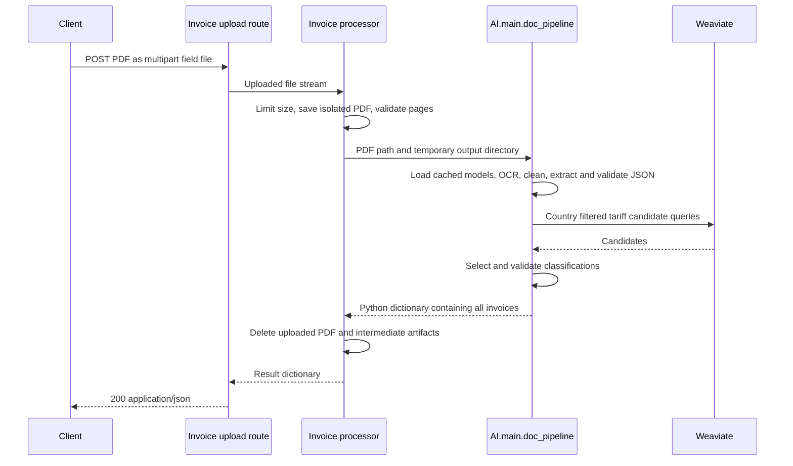

# Invoice API

## Live invoice job progress over WebSocket

Upload a PDF with `POST /api/v1/invoices/jobs` (multipart field `file`), then connect to:

```text
ws://localhost:8000/ws/invoices/jobs/<job_id>?interval=1
```

Use `wss://<your-host>/ws/invoices/jobs/<job_id>` for HTTPS deployments. This socket monitors the same full extraction job created by the upload API. Fetch its details at any time with `GET /api/v1/invoices/jobs/<job_id>`; REST and socket snapshots expose the same job fields.

```javascript
async function extractInvoice(file) {
  const body = new FormData();
  body.append("file", file);
  const response = await fetch("/api/v1/invoices/jobs", { method: "POST", body });
  if (!response.ok) throw new Error(await response.text());
  const accepted = await response.json();
  console.log("Job ID:", accepted.job_id);
  // Save this ID in application state so the user can reconnect later.
  const url = new URL(`/ws/invoices/jobs/${accepted.job_id}`, location.href);
  url.protocol = location.protocol === "https:" ? "wss:" : "ws:";
  const socket = new WebSocket(url);
  socket.onmessage = ({ data }) => {
    const message = JSON.parse(data);
    if (message.event === "error") {
      console.error(message.detail);
      return;
    }
    const job = message.job;
    console.log({
      jobId: job.job_id,
      status: job.status,
      processing: job.stage_description,
      estimatedPercent: job.progress_percent,
      queuePosition: job.queue_position,
    });
    if (message.event === "completed") console.log("Extracted JSON:", job.result);
    if (message.event === "failed") console.error(job.error);
  };
  socket.onerror = () => console.error("Connection error; reconnect using the saved job ID");
  return { jobId: accepted.job_id, socket };
}
```

Example event while waiting:

```json
{
  "event": "progress",
  "job": {
    "job_id": "0123456789abcdef0123456789abcdef",
    "status": "queued",
    "stage": "queued",
    "stage_description": "Waiting in the invoice queue",
    "progress_percent": 0,
    "progress_is_estimate": true,
    "queue_position": 2,
    "filename": "invoice.pdf",
    "created_at": "2026-10-18T12:00:00Z",
    "updated_at": "2026-10-18T12:00:00Z",
    "result": null,
    "error": null
  }
}
```

- `queue_position`: `1` is the next waiting job; `2` means one waiting job is ahead, plus any job already processing. `0` means the worker has taken the job, though it can still wait for the shared pipeline lock. Terminal jobs use null. Position is also null if a queued job belongs to another process whose queue cannot be inspected.
- `progress_percent` is a **stage-based estimate**, not measured page/item completion or an elapsed-time prediction. It remains unchanged during a long stage. Stages use 0 (queued), 1 (starting), 5 (tariff setup), 10 (model loading/reuse), 20 (OCR), 45 (cleanup), 55 (JSON extraction), 75 (retrieval), 85 (classification), and 99 (finalization). Only saved success reaches 100. Failures retain the last recorded estimate.
- `stage` is the machine-readable stage; `stage_description` explains what is processing.
- The socket immediately sends the current snapshot and sends another at the selected interval (1–60 seconds, default 1). Intermediate stages shorter than that interval may be skipped. Repeated unchanged snapshots also keep the connection active.
- Events are `progress`, `completed`, or `failed`, each containing `job`. Terminal events include the final result/error and close normally with code `1000`.
- Unknown or invalid job IDs produce an `error` event with status `404` and close code `4404`. The stream accepts no client messages; unexpected messages close it with `1008`.
- Disconnecting only stops monitoring; extraction continues. Reconnect with the same job ID for a fresh snapshot or saved result. Server restarts still interrupt active work; this feature does not restart jobs automatically.
- Use one API worker per GPU. Queue position covers background invoice jobs in that process; direct HTTP/old upload sockets do not have queue numbers. The synchronous `/api/v1/invoices/extract` response has no background job ID: use `/api/v1/invoices/jobs` for this tracked workflow.
- Authentication and job ownership checks are not implemented. A job ID is not a substitute for authenticated access control.


The server supports PDF uploads that return AI invoice JSON directly, plus the existing asynchronous OCR jobs and model-cache status endpoints. Python 3.11 or later is required by the server's existing `StrEnum` schemas.

For connection URLs, PDF upload messages, GPU events, and complete browser/Python clients, see the [WebSocket connection guide](WEBSOCKET_GUIDE.md).

## Start the server

Install the AI and server dependencies from the repository root, using a CUDA-enabled environment with BF16 GPU support for Unlimited-OCR:

```bash
python -m pip install -r AI/requirements.txt -r server/requirements.txt
uvicorn server.app:app --host 0.0.0.0 --port 8000
```

From another directory, supply the checkout path to Uvicorn:

```bash
uvicorn --app-dir /workspace server.app:app --host 0.0.0.0 --port 8000
```

Interactive API documentation is available at `http://localhost:8000/docs`. Importing the app does not load models or connect to the database. Models load on the first processing request and remain cached in that process. Use one worker per GPU unless memory is provisioned for multiple model copies.

Install dependencies with the same Python interpreter used to launch Uvicorn. For the existing `/workspace/server/venv` environment on the A100 host, use:

```bash
/workspace/server/venv/bin/python -m pip install torch==2.10.0 torchvision==0.25.0 --index-url https://download.pytorch.org/whl/cu128
/workspace/server/venv/bin/python -m pip install -r /workspace/AI/requirements.txt -r /workspace/server/requirements.txt
/workspace/server/venv/bin/python -m uvicorn server.app:app --app-dir /workspace --host 0.0.0.0 --port 8000
```

The CUDA 12.8 wheels above use the matching versions in the [official PyTorch installation commands](https://pytorch.org/get-started/previous-versions/#v2100). Installing only the server requirements provides the HTTP framework; PDF validation, models, and database retrieval also require the AI requirements in that same environment. Restart Uvicorn after installing dependencies.

## nginx gateway timeouts

On this RunPod host, nginx listens on port `8001` and proxies to Uvicorn on port `8000`. A synchronous model download, cold model load, or invoice extraction can exceed nginx's default 60-second upstream read timeout. nginx then returns HTML `504 Gateway Time-out`, even though the worker may still be processing the request. This timeout measures the gap between reads from the upstream, not the total job duration. See the [nginx proxy timeout documentation](https://nginx.org/en/docs/http/ngx_http_proxy_module.html#proxy_read_timeout).

The active API location now includes `/workspace/server/deploy/nginx-api.conf`. It preserves the host's WebSocket and forwarding headers, sets `proxy_read_timeout` and `proxy_send_timeout` to `3600s`, and disables interception of FastAPI errors. This keeps upstream error statuses and JSON bodies intact instead of routing them through the host's HTML error page. The include uses the forwarding and upgrade maps already defined in this host's nginx configuration.

For this host, the API proxy location is:

```nginx
location / {
    add_header Cache-Control no-cache;
    include /workspace/server/deploy/nginx-api.conf;
    proxy_pass http://localhost:8000;
}
```

Use this API include in place of `snippets/nginx-proxy.conf` for the API location; including both would duplicate some directives. Other proxy locations are unchanged. Validate and apply nginx changes using:

```bash
nginx -t
nginx -s reload
```

The original host configuration was backed up to `/etc/nginx/nginx.conf.invoice-api.bak`. Host nginx configuration may need to be reapplied when recreating the container. Any external proxy or client timeout must also allow the requested processing time; this local change does not configure an external gateway.

After a timed-out download, check `GET /api/v1/models/status` before starting it again: downloaded files remain in the cache. For streamed invoice progress and results, use `/ws/invoices/extract`. The HTTP upload and download endpoints continue to return their result in the same request.

## Download and store the models

**`POST /api/v1/models/download`** downloads both configured model repositories into the shared Hugging Face cache. It does not instantiate a tokenizer or model, import Torch, run inference, connect to Weaviate, or allocate GPU memory. Existing loaded models are left in memory unchanged.

```bash
curl -X POST http://localhost:8000/api/v1/models/download
```

No request body or PDF is required. The request waits until both downloads finish, then returns `200` with their model IDs, resolved revisions, and absolute snapshot locations. For example (revision values abbreviated):

```json
{
  "models": [
    {
      "model_id": "baidu/Unlimited-OCR",
      "revision": "ocr-commit-hash",
      "location": "/workspace/.cache/huggingface/hub/models--baidu--Unlimited-OCR/snapshots/ocr-commit-hash"
    },
    {
      "model_id": "Qwen/Qwen2.5-7B-Instruct",
      "revision": "qwen-commit-hash",
      "location": "/workspace/.cache/huggingface/hub/models--Qwen--Qwen2.5-7B-Instruct/snapshots/qwen-commit-hash"
    }
  ]
}
```

Repository defaults can be changed with `OCR_MODEL_ID` and `QWEN_MODEL_ID`; optional `OCR_MODEL_REVISION` and `QWEN_MODEL_REVISION` select branches, tags, or commits. The downloader and inference loaders share the same cache resolution: `HF_HUB_CACHE`, then `HUGGINGFACE_HUB_CACHE`, then `HF_HOME/hub`, then the standard XDG/home Hugging Face cache. Set environment variables before starting the server. `HF_TOKEN` is supported by the Hugging Face client if repository authentication is needed.

Downloads use Hugging Face's [`snapshot_download()`](https://huggingface.co/docs/huggingface_hub/guides/download#download-an-entire-repository) to store complete repositories, including weights, tokenizer files, configurations, and custom model code. Repeated calls reuse unchanged cached files, while checking the requested revision. Pin a commit revision to keep subsequent calls on the same snapshot. Downloading repository code does not execute it.

Use `GET /api/v1/models/status` to inspect cached configurations and weights, including all shards listed in a weight index. The first invoice request still loads the cached weights into memory; later requests in the same server process reuse the loaded models. Cached files persist across server restarts. Allow enough HTTP client/proxy time for large downloads. A download failure returns `502` with a generic error and logs the exception on the server; completed files remain cached for a later retry.

## GPU availability and live usage

**`GET /api/v1/gpu/status`** reports CUDA availability, GPU usage, and the runtime configuration needed by the AI pipeline:

```bash
curl http://localhost:8000/api/v1/gpu/status
```

**`WS /ws/gpu?interval=2`** streams the same status as a `gpu_status` event. It sends the first sample as soon as available, then samples at the requested interval. `interval` is in seconds, defaults to `2`, and must be between `1` and `60`. Use the externally exposed hostname and `wss://` when connecting through HTTPS.

Browser client:

```javascript
const socket = new WebSocket("ws://localhost:8000/ws/gpu?interval=2");
socket.onmessage = ({data}) => {
  const message = JSON.parse(data);
  if (message.event === "gpu_status") {
    console.log(message.data.available, message.data.in_use);
    console.table(message.data.gpus);
    console.log(message.data.configuration);
  } else {
    console.error(message.detail);
  }
};
// Stop live monitoring when no longer needed:
// socket.close();
```

The event shape is `{"event":"gpu_status","data":{...}}`. `data` has the same schema as the HTTP response. The stream is receive-only; sending application messages closes it with code `1008`. WebSocket ping/pong frames are handled by the server transport. Closing the connection stops that subscriber's polling.

| Field | Meaning |
| --- | --- |
| `sampled_at` | UTC timestamp of this measurement |
| `available` | Whether PyTorch can access a CUDA device; null if the check failed |
| `in_use` | True when a monitored GPU has a compute process or positive GPU utilization |
| `active` | True when measured GPU utilization is above zero |
| `telemetry_available` | Whether NVIDIA driver telemetry queries completed |
| `gpus` | Per-device configuration, utilization, memory, temperature, power, and compute processes |
| `configuration` | Python/PyTorch versions, CUDA runtime and driver versions, visibility settings, BF16 hardware check, and model-loaded flags |
| `errors` | Diagnostics when runtime checks or driver metrics are unavailable |

Each device includes `index`, `uuid`, `name`, `driver_version`, `compute_capability`, `bf16_supported`, `total_memory_mib`, `used_memory_mib`, `free_memory_mib`, `gpu_utilization_percent`, `memory_utilization_percent`, `temperature_c`, `power_draw_w`, `active`, `in_use`, and `processes`. Memory amounts are in MiB, percentages are 0 to 100, temperature is Celsius, and power is watts. The memory-utilization percentage measures memory activity, not the fraction of allocated VRAM; use the memory sizes for VRAM occupancy.

A model can occupy GPU memory while `active=false`, so `in_use` may still be true. Driver-reserved memory alone is not treated as an active compute process. Unsupported measurements and unknown usage return null rather than a misleading zero/false. Process names may be null when host processes cannot be inspected from the container. Process IDs are NVIDIA driver-reported IDs and may belong to the host PID namespace.

`configuration.loaded_models.ocr` and `.qwen` describe objects cached in the API worker serving this request, not other processes. No model is loaded by monitoring. Multiple API workers each have their own model cache and one-second telemetry cache. Monitoring samples are taken on worker threads; subscribers share recent measurements instead of launching a separate monitoring process per connection.

`configuration.ocr_gpu_ready` checks PyTorch CUDA availability and native BF16 hardware capability. It is not a guarantee of sufficient free VRAM, installed model files, or successful inference. BF16 is checked from NVIDIA compute capability without initializing a CUDA context. Mixed or unknown monitored GPU capabilities produce null for BF16 readiness. NVIDIA telemetry can expose physical devices hidden by `CUDA_VISIBLE_DEVICES`; PyTorch's device count and availability reflect the API process's CUDA visibility.

Telemetry uses the read-only [NVIDIA NVML Python bindings](https://docs.nvidia.com/deploy/nvidia-smi/index.html), provided by `nvidia-ml-py` in `server/requirements.txt`. Monitoring does not allocate GPU tensors, load models, or change GPU settings. The HTTP endpoint returns `200` with availability/diagnostics on CPU-only hosts or when the NVIDIA driver is unavailable. A missing or incompatible driver cannot provide utilization metrics. A cold initial request may take longer while importing PyTorch. Neither these responses nor the socket stream expose Hugging Face tokens or the full environment.

## Background invoice extraction behind Cloudflare

Use **`POST /api/v1/invoices/jobs`** for invoice uploads through the RunPod/Cloudflare proxy. It validates and stores the uploaded PDF, queues the full AI pipeline, and returns `202` without waiting for model loading or inference. The request body is the same multipart field `file` used by the synchronous endpoint.

```bash
curl -X POST http://localhost:8000/api/v1/invoices/jobs \
  -F "file=@invoice.pdf;type=application/pdf"
```

The response includes `job_id`, `status: "queued"`, `stage`, filename, timestamps, and null `result`/`error` fields. The `Location` response header gives the polling URL, and `Retry-After: 2` suggests waiting two seconds between checks.

Poll **`GET /api/v1/invoices/jobs/{job_id}`**:

```bash
curl http://localhost:8000/api/v1/invoices/jobs/YOUR_JOB_ID
```

| Status | Meaning |
| --- | --- |
| `queued` | Validated PDF is waiting for the background worker |
| `processing` | Pipeline is running; `stage` reports its current step |
| `succeeded` | `result.invoices` contains the complete extracted and classified invoice JSON |
| `failed` | `error` explains the failure; detailed pipeline exceptions are logged on the server |

A poll always returns `200` for an existing job, including failed jobs. Unknown IDs return `404`. Invalid uploads are rejected before acceptance with `413`, `415`, or `422`, using the same validation rules as the synchronous endpoint. Poll responses use `Cache-Control: no-store`.

Python client example:

```python
import time
import httpx

# Replace with your RunPod HTTPS hostname when calling from outside the pod.
base = "http://localhost:8000"
with httpx.Client(timeout=60) as client:
    with open("invoice.pdf", "rb") as pdf:
        response = client.post(base + "/api/v1/invoices/jobs",
                               files={"file": ("invoice.pdf", pdf, "application/pdf")})
    response.raise_for_status()
    poll_url = base + response.headers["location"]
    while True:
        response = client.get(poll_url)
        response.raise_for_status()
        job = response.json()
        if job["status"] == "succeeded":
            print(job["result"])
            break
        if job["status"] == "failed":
            raise RuntimeError(job["error"])
        print(job["status"], job["stage"])
        time.sleep(2)
```

The worker runs the same `InvoiceProcessor` and `AI.main.doc_pipeline()` as the direct HTTP and WebSocket endpoints. Jobs run serially in one background thread per API process; invoice processing still shares the pipeline's GPU lock. Closing the upload/polling HTTP connection does not cancel the accepted job.

Job metadata and final results are saved atomically under `INVOICE_JOB_DIR`, which defaults to `/workspace/output/invoice_jobs`. Each job owns a directory with `job.json` and a temporary `invoice.pdf`; the PDF is deleted when processing finishes. Final JSON remains available across normal process restarts. Retain this directory on persistent storage and remove completed job directories when their results are no longer needed. The service does not automatically expire results.

Run one API worker per GPU. Use the normal server command without `--reload` while processing invoices: a restart or automatic reload interrupts active/queued jobs. Interrupted jobs are marked failed when polled after their owner exits; they are not automatically resumed and must be submitted again. Finished results remain readable. These full-pipeline jobs are separate from the older OCR-only `/api/v1/jobs` endpoints.

A Cloudflare **524** is an outer gateway timeout, separate from local nginx's **504**. The attached incident was an invoice extraction request that remained open through inference. Increasing the local nginx read timeout does not change Cloudflare's limit. [Cloudflare recommends status polling for long-running HTTP operations](https://developers.cloudflare.com/support/troubleshooting/http-status-codes/cloudflare-5xx-errors/error-524/). Keep `/api/v1/invoices/extract` for synchronous calls that fit the proxy/client timeout, or use `/ws/invoices/extract` for streamed progress.

## Upload an invoice and receive JSON

**`POST /api/v1/invoices/extract`** accepts `multipart/form-data` with one required field named `file`. The filename must end in `.pdf`; the server also checks that the content is a readable, unencrypted PDF before invoking AI.

```bash
curl -X POST http://localhost:8000/api/v1/invoices/extract \
  -F "file=@/absolute/path/invoice.pdf;type=application/pdf"
```

In Windows PowerShell, use `curl.exe` and your Windows PDF path. In Postman, choose **Body → form-data**, add a key named `file` with type **File**, select the PDF, and send the request. The `/docs` interface also provides an upload control for this endpoint.

This synchronous HTTP request waits for the complete pipeline and can exceed an external gateway timeout. Prefer `/api/v1/invoices/jobs` through Cloudflare. Successful synchronous responses return status `200` and the AI result as a JSON object with `invoices`, rather than a job ID, file path, or encoded JSON string. For example, the response structure below abbreviates the extraction fields:

```json
{
  "invoices": [
    {
      "order_level": {
        "invoice_number": "INV-001",
        "receiver_country": "Finland",
        "total_amount": 20.0
      },
      "item_level": [
        {
          "sku_code": "CABLE-1",
          "product_description": "Insulated electric cable",
          "hs6_code": null,
          "destination_country_hts_code": null,
          "needs_review": true,
          "confidence": "LOW"
        }
      ],
      "shipment": {
        "invoice_number": "INV-001",
        "invoice_date": null,
        "currency": null
      }
    }
  ]
}
```

The actual response includes all extracted schema fields and classification metadata. Every invoice and item is included. A null tariff code is a successful, reviewable result when the product details or retrieved candidates do not support classification.

## Upload an invoice through WebSocket

Connect to **`ws://localhost:8000/ws/invoices/extract`**. Use `wss://` when the server is behind HTTPS. This endpoint runs the same `InvoiceProcessor` and full AI pipeline as the HTTP upload endpoint, including cached models, Weaviate configuration, validation, and temporary-file cleanup.

Each connection handles one PDF:

1. Send a JSON text message containing the filename and the exact file size in bytes: `{"filename":"invoice.pdf","size":12345}`. The size must be a positive integer within `INVOICE_MAX_UPLOAD_BYTES`.
2. Wait for `{"event":"ready","max_upload_bytes":26214400}`. If metadata is invalid, the server sends an error and closes the connection.
3. Send the PDF bytes in one or more **binary** messages. Use chunks such as 256 KiB to stay below the WebSocket server's per-message limit. Send exactly the declared byte count; no separate end marker or multipart encoding is needed.
4. Receive `{"event":"processing"}` followed by progress messages such as `{"event":"progress","stage":"running_ocr"}` and `{"event":"progress","stage":"extracting_json"}`.
5. Receive `{"event":"completed","result":{"invoices":[...]}}`. The `result` object has the same schema as the HTTP response. The server then closes normally with WebSocket code `1000`.

Pipeline stages are `loading_tariff_index`, `loading_models`, `running_ocr`, `cleaning_text`, `extracting_json`, `retrieving_tariffs`, `classifying_items`, and `completed`. A `loading_models` progress message also occurs when the loader returns cached models; it does not mean model weights are reloaded. Processing runs in a worker thread while progress messages are sent on the event loop. The upload is spooled to disk above 1 MiB rather than keeping a complete large PDF in memory.

Python client example (install the client with `python -m pip install "websockets>=12"`):

```python
import json
from pathlib import Path
from websockets.sync.client import connect

pdf = Path("invoice.pdf")
with connect("ws://localhost:8000/ws/invoices/extract", max_size=None) as socket:
    socket.send(json.dumps({"filename": pdf.name, "size": pdf.stat().st_size}))
    ready = json.loads(socket.recv())
    if ready["event"] != "ready":
        raise RuntimeError(ready["detail"])
    with pdf.open("rb") as source:
        while chunk := source.read(256 * 1024):
            socket.send(chunk)
    for raw in socket:
        message = json.loads(raw)
        if message["event"] == "completed":
            print(json.dumps(message["result"], indent=2))
            break
        if message["event"] == "error":
            raise RuntimeError(message["detail"])
        print(message)
```

Browser clients follow the same protocol: send metadata using `JSON.stringify({filename: file.name, size: file.size})`, wait for `ready`, then send `await file.slice(start, end).arrayBuffer()` for each binary chunk. Parse incoming text messages as JSON and read `message.result` on `completed`.

WebSocket errors have the shape `{"event":"error","status":422,"detail":"..."}`. The `status` field uses the HTTP endpoint's error meanings: `413` for excessive size, `415` for a non-PDF filename, `422` for invalid metadata/content or a byte-count mismatch, and `502` for a failed pipeline or invalid AI response. These are JSON status values after the WebSocket handshake, not HTTP response codes. The server closes with `1009` for excessive size, `1008` for invalid input, and `1011` for a pipeline failure.

Disconnecting during upload discards the incomplete upload and does not invoke AI. A connection that sends fewer bytes than declared must send the remainder or disconnect; processing starts only when the exact size is received. An inference operation already running in a worker cannot be interrupted immediately by a client disconnect; cleanup occurs as that operation exits. Socket results are not stored for later polling.

## Request flow



In Weaviate mode the AI pipeline opens its database connection before loading the models, queries candidates after extraction, and closes the connection in a `finally` block. The route runs its blocking upload processing and inference in FastAPI's worker thread pool, allowing async health and status routes to continue serving requests. Full pipeline inference is serialized by the shared AI pipeline lock.

`server/routes/invoices.py` defines the HTTP contract. `server/services/invoices.py` validates and stages the upload, then calls the shared `AI.main.doc_pipeline()`. User filenames are never used as storage paths. Each request owns a temporary directory that is removed on success and failure; uploaded PDFs and JSON artifacts are not retained by this endpoint. The existing path-based OCR jobs retain their own output files.

## Configuration

| Variable | Default | Purpose |
| --- | --- | --- |
| `INVOICE_TARIFF_BACKEND` | `weaviate` | Use the configured DB, or choose `catalog` |
| `INVOICE_JOB_DIR` | `/workspace/output/invoice_jobs` | Persisted full-pipeline job status and JSON results |
| `INVOICE_MAX_UPLOAD_BYTES` | `26214400` | Maximum invoice file size, 25 MiB, checked while copying the parsed upload |
| `WEAVIATE_HOST` | `32.236.127.40` | HTTP and gRPC host |
| `WEAVIATE_HTTP_PORT` | `8080` | HTTP port |
| `WEAVIATE_GRPC_PORT` | `50051` | gRPC port |
| `WEAVIATE_HTTP_SECURE` | `false` | Enable HTTPS when true |
| `WEAVIATE_GRPC_SECURE` | `false` | Enable gRPC TLS when true |
| `HS_CATALOG_PATH` | Unset | Local HS CSV for catalog mode; otherwise downloaded at runtime |
| `NATIONAL_INDEX_PATH` | Unset | Optional national overlay JSON for catalog mode |

The Weaviate connection sends no API key. The existing country mapping API is used to resolve database country IDs. Its country labels include ISO suffixes and optional trade-bloc annotations, such as `Finland - FI (EU)`. Standard country entries are preferred over alternate tariff schedules. See [`AI/README.md`](../AI/README.md) for the collection schema, reference-data formats, model environment variables, and classification behavior.

Configure the HTTP client or reverse proxy to allow enough time for model loading and inference. The first request can also download model weights if they are not already cached. The direct upload endpoint does not create a background job or expose WebSocket progress.

## Errors

| Status | Meaning |
| --- | --- |
| `413` | PDF exceeds `INVOICE_MAX_UPLOAD_BYTES` |
| `415` | Uploaded filename is not a PDF filename |
| `422` | File is missing, empty, malformed, password protected, or has no readable pages |
| `502` | Model loading, OCR, extracted schema validation, database retrieval, or final response validation failed |

Errors return `{"detail": "..."}`. Pipeline failures are logged on the server; internal exception details are not returned to clients. Individual tariff-classification failures remain reviewable item results according to the AI pipeline contract.

## Existing endpoints

- `GET /api/v1/gpu/status` reports GPU availability, utilization, and runtime configuration.
- `WS /ws/gpu?interval=2` streams `gpu_status` events.
- `POST /api/v1/invoices/jobs` uploads a PDF, queues full extraction, and returns `202`.
- `GET /api/v1/invoices/jobs/{job_id}` returns progress and the final invoice JSON.
- `GET /api/v1/health`
- `GET /api/v1/models/status` checks local model directories and the Hugging Face cache without loading models.
- `POST /api/v1/models/download` downloads and stores both model repositories without loading them into memory.
- `POST /api/v1/jobs` with `{"document_path": "/absolute/invoice.pdf"}` starts an asynchronous OCR-only job and returns `202` with a job ID.
- `GET /api/v1/jobs/{job_id}` returns OCR job status and output paths.
- `WS /ws/jobs/{job_id}` streams OCR job lifecycle and progress events.
- `WS /ws/invoices/extract` accepts a PDF upload and returns full AI invoice JSON with progress events.

## Tests

After installing the AI and server dependencies, install the HTTP test client and run both suites from the checkout root:

```bash
python -m pip install "httpx>=0.28,<1"
python -m unittest discover -s server/tests -v
python -m unittest discover -s AI/tests -v
```

API tests cover background acceptance before inference completes, progress polling, persisted results, interrupted workers, upload cleanup, GPU telemetry, configuration checks, CPU fallback, cached samples, and live socket events. They also exercise model download requests with mocked Hub downloads, partial weight-shard checks, multipart and WebSocket PDF uploads, progress events, chunked transfers, disconnect cleanup, PDF validation, the shared pipeline with fake models, multiple invoices, Weaviate backend selection, error responses, and the existing health/status routes. They do not require a GPU or live DB. A live end-to-end inference check still requires downloaded model weights, CUDA BF16 support, and a reachable configured retrieval backend.
