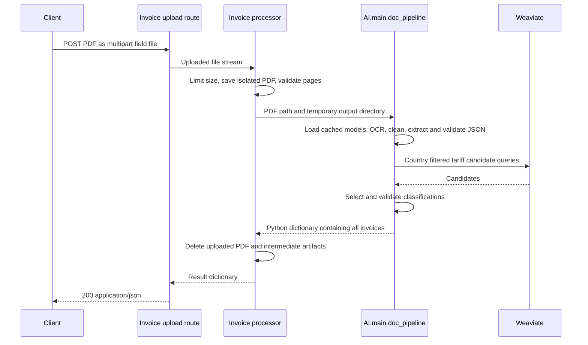

# Invoice API

The server supports PDF uploads that return AI invoice JSON directly, plus the existing asynchronous OCR jobs and model-cache status endpoints. Python 3.11 or later is required by the server's existing `StrEnum` schemas.

## Start the server

Install the AI and server dependencies from the repository root, using a CUDA-enabled environment with BF16 GPU support for Unlimited-OCR:

```bash
python -m pip install -r AI/requirements.txt -r server/requirements.txt
uvicorn server.app:app --host 0.0.0.0 --port 8000
```

From another directory, supply the checkout path to Uvicorn:

```bash
uvicorn --app-dir /workspace server.app:app --host 0.0.0.0 --port 8000
```

Interactive API documentation is available at `http://localhost:8000/docs`. Importing the app does not load models or connect to the database. Models load on the first processing request and remain cached in that process. Use one worker per GPU unless memory is provisioned for multiple model copies.

## Upload an invoice and receive JSON

**`POST /api/v1/invoices/extract`** accepts `multipart/form-data` with one required field named `file`. The filename must end in `.pdf`; the server also checks that the content is a readable, unencrypted PDF before invoking AI.

```bash
curl -X POST http://localhost:8000/api/v1/invoices/extract \
  -F "file=@/absolute/path/invoice.pdf;type=application/pdf"
```

In Windows PowerShell, use `curl.exe` and your Windows PDF path. In Postman, choose **Body → form-data**, add a key named `file` with type **File**, select the PDF, and send the request. The `/docs` interface also provides an upload control for this endpoint.

The HTTP request waits for the complete pipeline. Successful responses return status `200` and the AI result as a JSON object with `invoices`, rather than a job ID, file path, or encoded JSON string. For example, the response structure below abbreviates the extraction fields:

```json
{
  "invoices": [
    {
      "order_level": {
        "invoice_number": "INV-001",
        "receiver_country": "Finland",
        "total_amount": 20.0
      },
      "item_level": [
        {
          "sku_code": "CABLE-1",
          "product_description": "Insulated electric cable",
          "hs6_code": null,
          "destination_country_hts_code": null,
          "needs_review": true,
          "confidence": "LOW"
        }
      ],
      "shipment": {
        "invoice_number": "INV-001",
        "invoice_date": null,
        "currency": null
      }
    }
  ]
}
```

The actual response includes all extracted schema fields and classification metadata. Every invoice and item is included. A null tariff code is a successful, reviewable result when the product details or retrieved candidates do not support classification.

## Request flow



In Weaviate mode the AI pipeline opens its database connection before loading the models, queries candidates after extraction, and closes the connection in a `finally` block. The route runs its blocking upload processing and inference in FastAPI's worker thread pool, allowing async health and status routes to continue serving requests. Full pipeline inference is serialized by the shared AI pipeline lock.

`server/routes/invoices.py` defines the HTTP contract. `server/services/invoices.py` validates and stages the upload, then calls the shared `AI.main.doc_pipeline()`. User filenames are never used as storage paths. Each request owns a temporary directory that is removed on success and failure; uploaded PDFs and JSON artifacts are not retained by this endpoint. The existing path-based OCR jobs retain their own output files.

## Configuration

| Variable | Default | Purpose |
| --- | --- | --- |
| `INVOICE_TARIFF_BACKEND` | `weaviate` | Use the configured DB, or choose `catalog` |
| `INVOICE_MAX_UPLOAD_BYTES` | `26214400` | Maximum invoice file size, 25 MiB, checked while copying the parsed upload |
| `WEAVIATE_HOST` | `32.236.127.40` | HTTP and gRPC host |
| `WEAVIATE_HTTP_PORT` | `8080` | HTTP port |
| `WEAVIATE_GRPC_PORT` | `50051` | gRPC port |
| `WEAVIATE_HTTP_SECURE` | `false` | Enable HTTPS when true |
| `WEAVIATE_GRPC_SECURE` | `false` | Enable gRPC TLS when true |
| `HS_CATALOG_PATH` | Unset | Local HS CSV for catalog mode; otherwise downloaded at runtime |
| `NATIONAL_INDEX_PATH` | Unset | Optional national overlay JSON for catalog mode |

The Weaviate connection sends no API key. The existing country mapping API is used to resolve database country IDs. See [`AI/README.md`](../AI/README.md) for the collection schema, reference-data formats, model environment variables, and classification behavior.

Configure the HTTP client or reverse proxy to allow enough time for model loading and inference. The first request can also download model weights if they are not already cached. The direct upload endpoint does not create a background job or expose WebSocket progress.

## Errors

| Status | Meaning |
| --- | --- |
| `413` | PDF exceeds `INVOICE_MAX_UPLOAD_BYTES` |
| `415` | Uploaded filename is not a PDF filename |
| `422` | File is missing, empty, malformed, password protected, or has no readable pages |
| `502` | Model loading, OCR, extracted schema validation, database retrieval, or final response validation failed |

Errors return `{"detail": "..."}`. Pipeline failures are logged on the server; internal exception details are not returned to clients. Individual tariff-classification failures remain reviewable item results according to the AI pipeline contract.

## Existing endpoints

- `GET /api/v1/health`
- `GET /api/v1/models/status` checks local model directories and the Hugging Face cache without loading models.
- `POST /api/v1/jobs` with `{"document_path": "/absolute/invoice.pdf"}` starts an asynchronous OCR-only job and returns `202` with a job ID.
- `GET /api/v1/jobs/{job_id}` returns OCR job status and output paths.
- `WS /ws/jobs/{job_id}` streams OCR job lifecycle and progress events.

## Tests

After installing the AI and server dependencies, install the HTTP test client and run both suites from the checkout root:

```bash
python -m pip install "httpx>=0.28,<1"
python -m unittest discover -s server/tests -v
python -m unittest discover -s AI/tests -v
```

API tests exercise real multipart requests, PDF validation, the shared pipeline with fake models, multiple invoices, Weaviate backend selection, cleanup, error responses, and the existing health/status routes. They do not require a GPU or live DB. A live end-to-end inference check still requires downloaded model weights, CUDA BF16 support, and a reachable configured retrieval backend.
